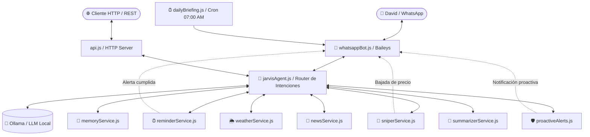

# 🤖 F.R.I.D.A.Y. — Personal Tactical AI Assistant

[](https://nodejs.org/)
[-25D366.svg)](https://github.com/WhiskeySockets/Baileys)
[](https://ollama.ai/)
[](LICENSE)

**F.R.I.D.A.Y.** (Female Replacement Intelligent Digital Assistant Youth) es una asistente de inteligencia artificial personal y táctica inspirada en la IA de Tony Stark en *Iron Man*. Se ejecuta de forma autónoma 24/7 en un servidor Linux (Oracle Cloud / VPS), conectada a **WhatsApp Multi-Device** y potenciada por modelos LLM locales ejecutados en **Ollama**.

---

## ⚡ Capacidades y Módulos

* **📱 WhatsApp Multi-Device 24/7 (`whatsappBot.js`):** Cliente de WhatsApp nativo con `@whiskeysockets/baileys`. Admite vinculación por código de 8 dígitos o código QR. Incluye filtro de seguridad estricto que solo responde al usuario autorizado (vía número y LID dinámico).
* **🧠 Second Brain / Memoria Personal (`memoryService.js`):** Almacenamiento persistente de datos personales (claves, cumpleaños, tallas, contactos, preferencias). Cuenta con normalización de caracteres, expansión de sinónimos y búsqueda con scoring semántico. Inyección contextual proactiva en el prompt para respuestas instantáneas.
* **⏰ Recordatorios y Alarmas Inteligentes (`reminderService.js`):** Detección en lenguaje natural de horas fijas (ej: *"a las 21:30"*, *"a las 9"*) y tiempos relativos (*"en 15 minutos"*, *"en 2 horas"*). Monitor proactivo en segundo plano que despacha alertas automáticas por WhatsApp al cumplirse.
* **🎯 Price Sniper / Item Tracker (`sniperService.js`):** Vigilancia automática periódica de precios de productos en Amazon y tiendas web. Bypasses móviles para Amazon. Notificaciones automáticas cuando el precio cae por debajo del objetivo y soporte para modificar objetivos sin reintroducir la URL.
* **🌦️ Radar Meteorológico Táctico (`weatherService.js`):** Integración con la API pública de Open-Meteo. Geocodificación inteligente en cascada para cualquier ciudad del mundo con soporte de comas y regiones. Previsiones actuales y para el día siguiente.
* **☀️ Briefing Matutino Automatizado (`dailyBriefing.js`):** Programado diariamente a las 07:00 AM (hora de Madrid). Genera y envía por WhatsApp un informe ejecutivo con el clima del día, alertas de lluvia y titulares de actualidad curados.
* **📰 Titulares y Noticias Curadas (`newsService.js`):** Extracción multirama (Tecnología, Política, Economía, Deportes, Internacional) a través de fuentes RSS de primer nivel, con filtros anti-clickbait y verificación de enlaces.
* **📄 Resumidor de Enlaces y Vídeos (`summarizerService.js`):** Descarga, parsea y sintetiza páginas web y transcripciones de vídeos de YouTube con formato ejecutivo para WhatsApp.
* **🛡️ Vigilante de Red y Salud del Servidor (`proactiveAlerts.js`):** Monitoreo continuo de puertos TCP (ej.: servidor de Minecraft), estado de la RAM/CPU del servidor y alertas meteorológicas.
* **💨 Easter Egg Stark:** Detección de peticiones especiales (ej: recarga de cachimba) con despacho directo de recursos multimedia y frases en personaje.
* **🌐 REST API Server (`api.js`):** Servidor HTTP con endpoints REST completos para chat, clima, memorias, recordatorios, tracker de productos y salud.

---

## 🏗️ Arquitectura del Sistema



---

## 🚀 Requisitos Previos

* **Node.js** 20.x o superior.
* **Ollama** instalado y ejecutándose localmente (`http://127.0.0.1:11434`).
* Una línea telefónica o SIM dedicada para el bot de WhatsApp (ej.: Simyo, Digi, etc.).
* Servidor Linux (VPS / Oracle Cloud Always Free / Raspberry Pi).

---

## 🛠️ Instalación y Puesta en Marcha

### 1. Clonar el repositorio
```bash
git clone https://github.com/tu-usuario/friday-ai.git
cd friday-ai
npm install
```

### 2. Configurar Variables de Entorno
Copia la plantilla `.env.example` a `.env`:
```bash
cp .env.example .env
```
Edita `.env` con tus credenciales y números autorizados:
```ini
# Identidades Telefónicas (con prefijo internacional sin signo +)
AUTHORIZED_USER_PHONE=34XXXXXXXXX   # Tu número personal
BOT_PHONE=34XXXXXXXXX               # Número de la SIM del bot
AUTHORIZED_USER_LID=XXXXXXXXXXXXXXX # LID de WhatsApp (se auto-detecta en el primer mensaje)

# Servidor de IA
OLLAMA_HOST=http://127.0.0.1:11434
OLLAMA_MODEL=jarvis

# Servidor API
PORT=3000

# Monitoreo de Red
MINECRAFT_HOST=192.168.1.X
MINECRAFT_PORT=25565

# Ubicación por Defecto
DEFAULT_CITY=Madrid
DEFAULT_LAT=40.4168
DEFAULT_LON=-3.7038
```

### 3. Crear el Modelo de Ollama
El proyecto incluye `Modelfile.jarvis` configurado para dotar a la IA de la personalidad de F.R.I.D.A.Y.:
```bash
ollama create jarvis -f Modelfile.jarvis
```

### 4. Vincular WhatsApp
Ejecuta el asistente de vinculación:
```bash
./vincular-whatsapp.sh
```
* **Opción 1:** Genera un código de emparejamiento de 8 dígitos para introducir en WhatsApp (*Dispositivos vinculados > Vincular con número de teléfono*).
* **Opción 2:** Imprime un código QR directamente en la terminal para escanear con la cámara de WhatsApp.

---

## 🚀 Ejecución 24/7 con PM2

Para mantener a F.R.I.D.A.Y. en ejecución permanente con autoreinicio tras caídas o reinicios del servidor:

```bash
# Iniciar la API y el Bot de WhatsApp
pm2 start api.js --name "friday-api"
pm2 start whatsappBot.js --name "friday-whatsapp"

# Guardar la lista para arranque automático con el sistema
pm2 save
pm2 startup
```

---

## 🌐 Endpoints de la API REST

| Método | Endpoint | Descripción |
| :--- | :--- | :--- |
| `POST` | `/api/chat` | Envía una consulta en lenguaje natural a FRIDAY |
| `GET` | `/api/clima?lugar=Madrid` | Consulta meteorología y previsión de una ubicación |
| `GET` | `/api/memorias` | Lista o busca recuerdos en el Second Brain (`?buscar=query`) |
| `POST` | `/api/memorias` | Guarda permanentemente un nuevo hecho |
| `DELETE` | `/api/memorias?criterio=*` | Olvida un recuerdo específico o todos (`*`) |
| `GET` | `/api/recordatorios` | Lista recordatorios pendientes |
| `POST` | `/api/recordatorios` | Crea un recordatorio con hora o minutos |
| `DELETE` | `/api/recordatorios?criterio=*`| Cancela un recordatorio o todos (`*`) |
| `GET` | `/api/sniper` | Lista artículos vigilados en el tracker |
| `POST` | `/api/sniper` | Añade un artículo a vigilar o actualiza su precio objetivo |
| `DELETE` | `/api/sniper?criterio=*` | Cancela vigilancia de artículos |
| `POST` | `/api/resumir` | Extrae y resume una URL web o vídeo de YouTube |
| `GET` | `/api/briefing` | Genera bajo demanda el briefing matutino |
| `GET` | `/api/salud` | Retorna métricas de CPU, RAM del host y puertos TCP |

---

## 🔒 Privacidad y Seguridad

* **Sin fuga de credenciales:** Todas las sesiones de autenticación de WhatsApp (`data/auth_info_baileys/`), registros de memoria personal (`data/brain_memory.json`) y claves privadas están excluidos en `.gitignore`.
* **Filtro de remitente estricto:** El bot descarta automáticamente mensajes de cualquier remitente que no coincida con el número o LID autorizado en `.env`.
* **Procesamiento local:** Las consultas conversacionales y el razonamiento se ejecutan localmente en el servidor mediante Ollama, garantizando que tus datos personales no se envíen a nubes de terceros.

---

## 📜 Licencia

Distribuido bajo la Licencia MIT. Consulta el archivo `LICENSE` para más información.
