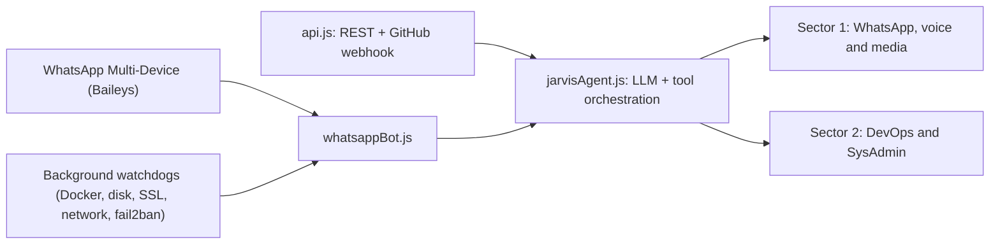

# D.A.V.I.S. (Digital Autonomous Voice & Intelligence System)

<p align="center">
  
</p>

<p align="center">
  <a href="LICENSE"></a>
  <a href="https://nodejs.org/"></a>
  <a href="https://ubuntu.com/"></a>
  <a href="tests/run_all.js"></a>
  <a href="https://github.com/WhiskeySockets/Baileys"></a>
</p>

Self-hosted personal AI assistant running 24/7 on an Oracle Cloud VPS under PM2. It pairs a sober J.A.R.V.I.S.-style persona (zero-emoji Spanish) with real SysAdmin and DevOps automation: WhatsApp multi-device chat over the native WebSocket protocol, multi-provider LLM tool calling, local Whisper.cpp voice transcription, Edge-TTS voice replies, and self-healing infrastructure watchdogs.

**What it solves:** one WhatsApp chat as the control surface for one person's digital operations - messaging, reminders, a personal knowledge base, media downloads and administration of a real Linux server, with an 804-test suite (802 passing, 2 explicit skips) gating every change that ships.

**Documentation:** architecture, engineering decisions, the full feature matrix, security standards and known limitations live on the [project documentation site](https://dcastellanos4.github.io/F.R.I.D.A.Y-bot/).

---

## Architecture at a Glance



---

## Quickstart

### 1. Requirements
- Node.js v20.x or higher (declared in `engines`)
- Linux host (developed for Ubuntu 22.04 LTS AArch64; service paths assume a Debian-like layout)
- `ffmpeg` and `yt-dlp` installed and present in system PATH
- Playwright Chromium browser: `npm run setup:browser` (required once per server; `npm ci`/`npm install` does not download browser binaries)

### 2. Installation
```bash
git clone https://github.com/DCastellanos4/F.R.I.D.A.Y-bot.git
cd F.R.I.D.A.Y-bot
npm install
npm run setup:browser
```

### 3. Configuration
Copy the configuration template:
```bash
cp .env.example .env
```

Configure required variables in `.env`:
```ini
# Authorized controller phone number (with country code, no +)
AUTHORIZED_USER_PHONE=34XXXXXXXXX

# Dedicated bot phone number
BOT_PHONE=34XXXXXXXXX

# LLM Provider: groq, openai, or ollama
LLM_PROVIDER=groq
OPENAI_API_KEY=gsk_your_api_key_here
OPENAI_BASE_URL=https://api.groq.com/openai/v1
OPENAI_MODEL=llama-3.3-70b-versatile

# REST API Port
PORT=3000

# Secret for the GitHub webhook endpoint
GITHUB_WEBHOOK_SECRET=your_secure_webhook_secret_here

# Encryption Master Key for Automated Backups
BACKUP_PASSPHRASE=your_ultra_secure_backup_passphrase_here
```

### 4. Running the Test Suite
Execute the unified master test runner and zero-emoji compliance scanner:
```bash
node tests/run_all.js
```

### 5. WhatsApp Pairing & Service Startup
Pair WhatsApp via terminal code or QR:
```bash
./vincular-whatsapp.sh
```

Start services under PM2:
```bash
pm2 start ecosystem.config.cjs
pm2 save
```

---

## License

MIT License. See [LICENSE](LICENSE) for details.
