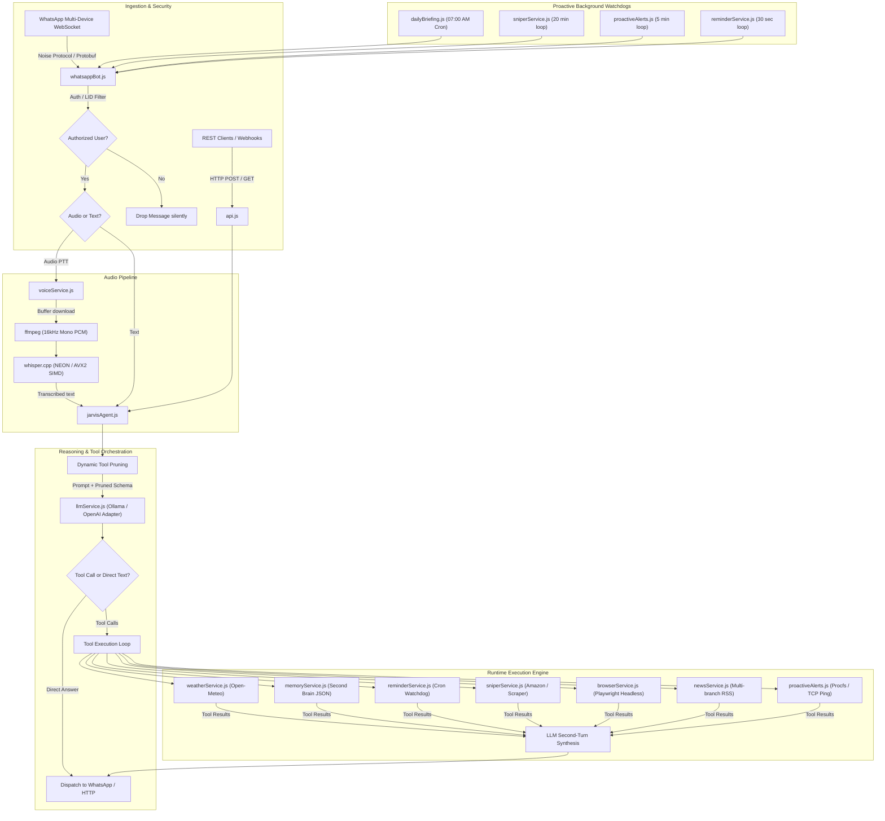

# FRIDAY (Female Replacement Intelligent Digital Assistant Youth)

[](LICENSE)
[](https://nodejs.org/)
[](https://playwright.dev/)
[](https://github.com/WhiskeySockets/Baileys)

Autonomous, self-hosted tactical AI assistant running 24/7 on Linux. It interfaces natively with WhatsApp via multi-device WebSockets, orchestrates tool calling across local LLMs (Ollama) or OpenAI-compatible cloud endpoints (Groq, OpenRouter, DeepSeek), transcribes voice notes via local whisper.cpp with SIMD acceleration, and browses dynamic web pages with headless Playwright.

---

## Technical Architecture

FRIDAY is built as an event-driven control plane where the primary user interface is a personal WhatsApp conversation. The assistant maintains conversational context, executes dynamic multi-turn tool calling, and triggers proactive background alerts (host telemetry, server uptime, price tracking, and scheduled morning briefings).



---

## Core Engineering Decisions & Internals

### 1. WhatsApp Multi-Device Protocol Handling (`whatsappBot.js`)
- **Protocol implementation:** Rather than relying on fragile browser automation or third-party paid gateways (Twilio, MessageBird), the gateway communicates directly over WebSockets using `@whiskeysockets/baileys`. This reverse-engineers the official WhatsApp Web protocol, handling end-to-end Signal encryption, Noise protocol handshakes, and Protobuf message framing.
- **Identity isolation and LID mapping:** WhatsApp routes messages using two separate identifier spaces: standard phone numbers (`[country_code][number]@s.whatsapp.net`) and Linked Identity Device identifiers (`[lid]@lid`). Incoming packets from linked devices frequently send the sender as an LID. The bot implements dual-identity validation with dynamic LID registration on the first handshake to reject unauthorized senders before any prompt parsing or model invocation occurs.
- **Presence heartbeat during long inference:** Local model generation on constrained CPUs (e.g., 4 vCPU Oracle Ampere) can take 5 to 25 seconds during heavy tool synthesis. WhatsApp clients typically drop connections or assume failure if no acknowledgement is made. The event loop sets an interval that ticks `sock.sendPresenceUpdate('composing', jid)` every 4 seconds, keeping the typing bubble alive on the recipient device and clearing it immediately when the stream completes.

### 2. Multi-Provider LLM Abstraction & Tool Calling (`llmService.js`)
- **Pluggable architecture:** Supports both local self-hosted instances (Ollama) and cloud OpenAI-compatible APIs (OpenAI, Groq, OpenRouter, DeepSeek, Together, vLLM) through a single configuration switch (`LLM_PROVIDER`).
- **Dynamic Tool Pruning (DTP):** Feeding a full schema of 12+ JSON function specifications into smaller local models (3B to 8B parameters) drastically increases context consumption and induces tool hallucination. `jarvisAgent.js` applies an intent classifier over normalized user input to prune the schema down to only relevant tools (e.g., stripping reminders, browser, and news tools during pure weather inquiries, and dropping all tools during chit-chat).
- **Two-turn execution protocol:** Standardizes assistant `tool_calls` parsing and response injection across differing backends. When a provider returns tool calls, the engine runs the target service, formats the output into standard `{ role: 'tool', tool_call_id, content }` payloads, and initiates the final synthesis completion pass.

### 3. Voice Transcription Pipeline (`voiceService.js`)
- **Pipeline:** WhatsApp PTT voice messages are downloaded into memory as raw Opus/OGG buffers.
- **Transcoding:** `ffmpeg` converts the input buffer via stdin pipes directly to 16-bit 16kHz mono PCM WAV, bypassing disk I/O bottlenecks.
- **Inference with whisper.cpp:** The audio is processed by `whisper.cpp` compiled with native hardware vector extensions (ARM NEON on Oracle Cloud AArch64; AVX2/FMA on x86_64). The transcription is fed back into the standard intent router as if the user had typed the command, prepending a transcription citation to the final WhatsApp message.

### 4. Dynamic Web Scraping & Cookie Bypass (`browserService.js`)
- **Playwright Chromium integration:** Scrapes JavaScript-heavy news outlets and sites with aggressive client-side rendering.
- **Stealth and footprint:** Launches headless Chromium with arguments (`--no-sandbox`, `--disable-setuid-sandbox`, `--disable-dev-shm-usage`, `--disable-blink-features=AutomationControlled`).
- **Sanitization:** Strips cookie consent overlays, sticky video headers, advertising iframes, and navigational DOM nodes (`nav`, `footer`, `header`, `aside`, `.ads`) before extracting inner text, truncating to safe context windows (4,500 tokens).
- **Cheerio fallback:** If Playwright fails or encounters a browser timeout, an HTTP fetch client with custom User-Agent headers and Cheerio HTML parsing acts as a low-overhead secondary extractor.

### 5. Persistent Memory / Second Brain (`memoryService.js`)
- **Deterministic JSON storage:** Maintains an atomic JSON database for user-specified attributes (passwords, clothing/shoe sizes, birthdays, server credentials, key facts).
- **Phonetic and diacritic normalization:** Strips accents, punctuation, and casing.
- **Proactive system prompt injection:** On every turn, the memory service searches for keywords matching the query. If a match is found, the fact is injected into the system prompt's `[DATOS RECORDADOS]` block, allowing the model to answer immediately without spending an extra tool execution cycle.

---

## Quickstart: Running in 5 Minutes (Cloud API)

If you are a recruiter or developer wanting to test FRIDAY without downloading local models or compiling C++ binaries, use a cloud provider like OpenAI, Groq, or OpenRouter.

### 1. Clone & Install Dependencies
```bash
git clone https://github.com/your-username/friday-ai.git
cd friday-ai
npm install
```

Ensure `ffmpeg` is installed on your host system:
```bash
# Ubuntu / Debian
sudo apt update && sudo apt install -y ffmpeg

# macOS (Homebrew)
brew install ffmpeg

# Windows (winget or chocolatey)
winget install Gyan.FFmpeg
```

### 2. Configure Environment
Copy the example configuration:
```bash
cp .env.example .env
```

Edit `.env` to set your phone numbers and API key:
```ini
# Your personal WhatsApp phone number (with country prefix, no +)
AUTHORIZED_USER_PHONE=34XXXXXXXXX

# Phone number of the SIM card linked to the bot
BOT_PHONE=34XXXXXXXXX

# Set provider to cloud
LLM_PROVIDER=openai

# Your provider key
OPENAI_API_KEY=sk-your-openai-api-key

# Optional: To use Groq (ultra-fast free tier):
# LLM_PROVIDER=groq
# OPENAI_API_KEY=gsk_your_groq_api_key
# OPENAI_BASE_URL=https://api.groq.com/openai/v1
# OPENAI_MODEL=llama-3.3-70b-versatile
```

### 3. Run Automated Tests
Verify configuration, provider auto-resolution, and tool handling:
```bash
npm test
```

### 4. Link WhatsApp
Run the interactive pairing script:
```bash
./vincular-whatsapp.sh
```
- Select **Option 1 (Phone Pairing Code)**: Enter the 8-character code shown on your terminal into WhatsApp under *Linked Devices > Link with phone number*.
- Or select **Option 2 (QR Code)**: Scan the ASCII QR code printed on your terminal with your phone's camera.

### 5. Start the Services
```bash
# Terminal interactive mode
npm run chat

# Full production mode
npm start           # Starts REST API on port 3000
npm run whatsapp    # Starts WhatsApp WebSocket daemon
```

---

## Full Self-Hosted Guide (Ollama + Whisper.cpp)

For total data privacy where no audio or text leaves your private server.

### 1. Host Requirements
- **OS:** Ubuntu 22.04 / 24.04 LTS (Oracle Cloud Always Free ARM64 Ampere 4 OCPU / 24GB RAM or equivalent x86_64 VPS).
- **RAM:** Minimum 8GB recommended.
- **Node.js:** v20.x or higher.

### 2. Install System Packages & Playwright
```bash
sudo apt update && sudo apt install -y curl git build-essential ffmpeg
curl -fsSL https://deb.nodesource.com/setup_20.x | sudo -E bash -
sudo apt install -y nodejs

# Install Playwright browser and Linux rendering dependencies
npx playwright install-deps chromium
npx playwright install chromium
```

### 3. Install & Configure Ollama
```bash
curl -fsSL https://ollama.com/install.sh | sh

# Pull the base model
ollama pull qwen2.5:3b

# Build the custom FRIDAY model profile
ollama create jarvis -f Modelfile.jarvis
```

### 4. Compile whisper.cpp with Hardware SIMD
```bash
git clone https://github.com/ggerganov/whisper.cpp.git
cd whisper.cpp

# Compile with native optimizations (-O3 and target architecture flags)
make -j4

# Download the compact multilingual model
bash ./models/download-ggml-model.sh base

# Symlink or verify binary is reachable in PATH or default path (/home/ubuntu/whisper.cpp)
./main -h
cd ..
```

### 5. Production Daemonization with PM2
```bash
sudo npm install -g pm2

pm2 start api.js --name "friday-api"
pm2 start whatsappBot.js --name "friday-whatsapp"

pm2 save
pm2 startup
```

---

## Configuration Reference

All settings are resolved through `config.js` reading from `.env`:

| Variable | Type | Default | Description |
| :--- | :--- | :--- | :--- |
| `AUTHORIZED_USER_PHONE` | String | Required | Personal phone number authorized to control the bot (e.g., `34600112233`). |
| `BOT_PHONE` | String | Required | Phone number assigned to the bot's SIM card. |
| `AUTHORIZED_USER_LID` | String | Auto-detected | WhatsApp Linked Identity Device ID (auto-discovered on first connection). |
| `LLM_PROVIDER` | String | `ollama` | Provider selector: `ollama`, `openai`, `groq`, `openrouter`, `deepseek`. |
| `OLLAMA_HOST` | URL | `http://127.0.0.1:11434` | Ollama daemon HTTP host endpoint. |
| `OLLAMA_MODEL` | String | `jarvis` | Local Ollama model tag. |
| `OPENAI_API_KEY` | String | Empty | API key for cloud provider. Setting this auto-selects cloud mode if `LLM_PROVIDER` is unset. |
| `OPENAI_BASE_URL` | URL | Provider default | Custom endpoint base URL (e.g., `https://api.groq.com/openai/v1`). |
| `OPENAI_MODEL` | String | Provider default | Cloud model identifier (e.g., `gpt-4o-mini`, `llama-3.3-70b-versatile`). |
| `PORT` | Integer | `3000` | REST API listening port. |
| `MINECRAFT_HOST` | String | `192.168.1.24` | IP address or domain for TCP ping health watchdog. |
| `MINECRAFT_PORT` | Integer | `25565` | TCP port for ping watchdog. |
| `DEFAULT_CITY` | String | `Madrid` | Fallback city for weather radar and morning briefings. |
| `DEFAULT_LAT` | Float | `40.4168` | Fallback latitude for Open-Meteo API. |
| `DEFAULT_LON` | Float | `-3.7038` | Fallback longitude for Open-Meteo API. |

---

## REST API Reference

The HTTP server (`api.js`) exposes control hooks for web dashboards, webhooks, or programmatic queries:

| Method | Endpoint | Request Body / Query | Description |
| :--- | :--- | :--- | :--- |
| `POST` | `/api/chat` | `{"mensaje": "..."}` | Executes agent pipeline and returns text response. |
| `GET` | `/api/clima` | `?lugar=Madrid&momento=hoy` | Fetches parsed forecast from Open-Meteo. |
| `GET` | `/api/memorias` | `?buscar=wifi` | Searches Second Brain persistent storage. |
| `POST` | `/api/memorias` | `{"sujeto": "wifi", "dato": "Pass123"}` | Stores a new fact in long-term memory. |
| `DELETE`| `/api/memorias` | `?criterio=wifi` (`*` for all) | Drops memory record matching search criteria. |
| `GET` | `/api/recordatorios` | None | Lists all active scheduled reminders. |
| `POST` | `/api/recordatorios` | `{"mensaje": "...", "hora": "21:30"}` | Schedules a reminder by clock time or minutes. |
| `DELETE`| `/api/recordatorios` | `?criterio=id` (`*` for all) | Cancels pending reminder. |
| `GET` | `/api/sniper` | None | Lists items currently tracked by price watchdog. |
| `POST` | `/api/sniper` | `{"url": "...", "precioObjetivo": 49}` | Registers an item for periodic price scraping. |
| `DELETE`| `/api/sniper` | `?criterio=id` | Detaches item from price watchdog. |
| `POST` | `/api/resumir` | `{"url": "https://..."}` | Fetches page with Playwright and returns summary. |
| `GET` | `/api/briefing` | None | Triggers on-demand morning briefing generation. |
| `GET` | `/api/salud` | None | Returns host CPU load, free RAM, and TCP ping status. |

---

## Security Model

- **Zero unauthorized execution:** Unregistered senders receive neither error messages nor status signals; their WebSockets packets are dropped immediately upon incoming packet decoding.
- **Credential hygiene:** Auth session tokens (`data/auth_info_baileys/`), personal database files (`data/brain_memory.json`, `data/sniper_items.json`, `data/reminders.json`), and `.env` credentials are excluded by gitignore.
- **Air-gapped operation:** When configured with Ollama and whisper.cpp, the entire stack (voice transcription, reasoning, tool execution, and response synthesis) runs locally on the host machine.

---

## License

MIT License. See [LICENSE](LICENSE) for details.
