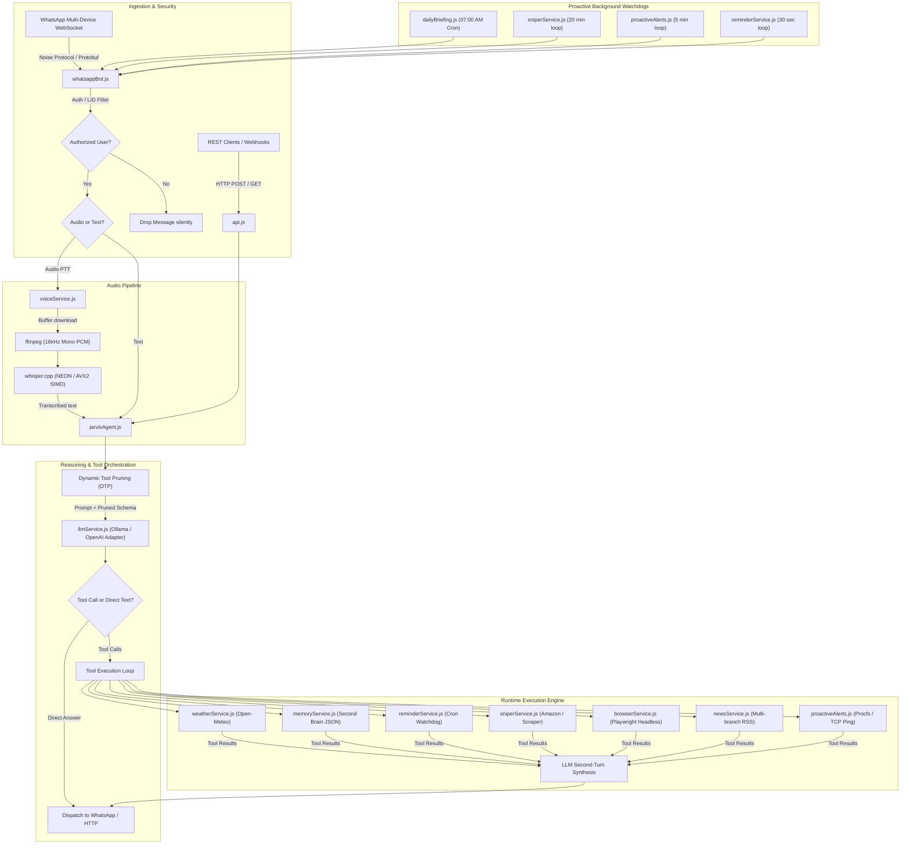
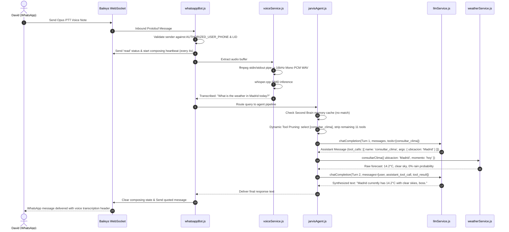

# FRIDAY (Female Replacement Intelligent Digital Assistant Youth)

[](LICENSE)
[](https://nodejs.org/)
[](https://playwright.dev/)
[](https://github.com/WhiskeySockets/Baileys)
[](https://ollama.com/)
[](https://platform.openai.com/)

Autonomous, self-hosted tactical AI assistant running 24/7 on Linux. It interfaces natively with WhatsApp via multi-device WebSockets, orchestrates tool calling across local LLMs (Ollama) or OpenAI-compatible cloud endpoints (Groq, OpenRouter, DeepSeek), transcribes voice notes via local whisper.cpp with SIMD hardware acceleration, and browses dynamic web pages with headless Playwright.

---

## Why I Built This (Engineering Philosophy)

Most AI assistant projects on GitHub are either toy web-chat wrappers around OpenAI's API or heavyweight enterprise frameworks that choke the moment a socket drops or an API rate-limit hits. 

I built FRIDAY because I wanted a real, production-ready personal assistant that lives in my everyday communication channel (WhatsApp), runs 24/7 on my Linux VPS (an Oracle Cloud Always Free ARM64 Ampere instance), and actually executes deterministic actions in the real world. 

Key architectural requirements I committed to from day one:
1. **Zero Cloud Egress Option**: When configured with local Ollama and whisper.cpp, not a single byte of personal audio, chat history, or Second Brain data ever leaves the VPS.
2. **Instant Cloud Onboarding**: For developers or recruiters who want to test the stack without compiling C++ binaries or downloading 4GB models, a single API key (OpenAI, Groq, OpenRouter, DeepSeek) gets the entire engine running in 5 minutes.
3. **Hardware-Level Performance**: Audio is transcoded entirely in RAM pipes via ffmpeg and fed to whisper.cpp compiled with target-specific SIMD vector instructions (ARM NEON or x86 AVX2).
4. **Resilient Network Handling**: WebSockets protocol reverse-engineering over Baileys with dual-identity validation (Phone Number + WhatsApp LID) and artificial presence heartbeats to prevent client timeouts during CPU inference.

---

## System Architecture

FRIDAY operates as an event-driven control plane where the primary interface is a direct WhatsApp WebSocket session backed by an auxiliary REST API server (`api.js`).



---

## End-to-End Sequence Flow

This diagram illustrates the full lifecycle of an inbound voice message requesting real-time weather information:



---

## Core Engineering Decisions & Internals

### 1. WhatsApp Multi-Device Protocol Handling (`whatsappBot.js`)
- **Protocol Reverse-Engineering:** Rather than running fragile desktop browser automation or paying for restricted enterprise Twilio/Cloud API numbers, FRIDAY connects directly over raw WebSockets using `@whiskeysockets/baileys`. It implements Noise protocol cryptography, Curve25519 key exchanges, and Protobuf message serialization.
- **Dual-Identity Architecture (Phone vs. LID):** Modern WhatsApp multi-device accounts route messages across two separate namespaces: standard MSISDNs (`[country_code][number]@s.whatsapp.net`) and Linked Identity Devices (`[lid]@lid`). Incoming packets from paired secondary devices (e.g., WhatsApp Web or desktop clients) identify the sender as an LID. The bot implements dynamic LID discovery on handshake and strict cryptographic verification: messages from unrecognized senders are dropped immediately without running prompt parsing or allocating memory.
- **Presence Heartbeat During CPU Inference:** Synthesizing multi-turn tool calling on a 4-vCPU ARM instance can take between 5 to 30 seconds. WhatsApp clients automatically reset typing indicators or disconnect after brief inactivity. The event loop fires `sock.sendPresenceUpdate('composing', jid)` every 4 seconds to maintain the active typing bubble on David's phone until the response stream concludes.

### 2. Multi-Provider LLM Abstraction & Dynamic Tool Pruning (`llmService.js` & `jarvisAgent.js`)
- **Pluggable Architecture:** Supports both self-hosted local inference (Ollama with custom `Modelfile.jarvis`) and OpenAI-compatible Cloud APIs (OpenAI, Groq, OpenRouter, DeepSeek, Together, vLLM) controlled by `LLM_PROVIDER`.
- **Dynamic Tool Pruning (DTP):** Feeding a full schema of 12+ function declarations into compact models (3B to 8B parameters) consumes 1,500+ prompt tokens and causes severe function hallucination. `jarvisAgent.js` runs a zero-overhead regex-based intent classification pass before invoking the LLM, pruning the schema down to only the relevant tools. Pure conversational chit-chat drops the tool schema entirely, reducing inference latency to ~1.2 seconds.
- **Cross-Provider Normalization:**
  - **Ollama:** Expects `tool_calls.arguments` as parsed JSON objects, `content: ""` (empty string), and accepts standard `role: 'tool'` responses.
  - **OpenAI / Groq / OpenRouter:** Strictly requires `tool_calls.arguments` as stringified JSON, `content: null` when tool calls are present (sending an empty string triggers HTTP 400 on Groq and OpenRouter), and explicit matching `tool_call_id` headers.
  - `llmService.js` handles bi-directional normalization transparently, including client lifecycle isolation to prevent test overrides from corrupting shared singletons.

### 3. Voice Transcription Pipeline (`voiceService.js`)
- **Buffer Streaming:** WhatsApp PTT voice notes are downloaded as raw Opus/OGG binary buffers directly in memory.
- **Zero-Disk Transcoding:** `ffmpeg` is spawned with `-i pipe:0 -ar 16000 -ac 1 -c:a pcm_s16le -f wav pipe:1`, converting incoming compressed audio into uncompressed 16kHz mono WAV through Unix pipes with zero disk I/O.
- **SIMD Hardware Acceleration:** Audio is handed to `whisper.cpp` compiled natively for the host architecture (`-march=armv8-a+simd` with NEON on Oracle ARM64; AVX2/FMA on x86_64). Transcription is prepended as a quote citation and routed into the standard intent engine.

### 4. Dynamic Web Scraping & Cookie Bypass (`browserService.js`)
- **Headless Playwright Chromium:** Used for modern JavaScript-heavy news outlets and sites with aggressive client-side rendering.
- **Stealth and Performance Flags:** Launches with `--no-sandbox`, `--disable-setuid-sandbox`, `--disable-dev-shm-usage`, and `--disable-blink-features=AutomationControlled` to minimize memory overhead on Linux VPS instances.
- **DOM Sanitization:** Strips cookie consent overlays, paywall prompts, video popups, ads, and navigational elements (`nav`, `footer`, `header`, `aside`, `.ads`, `.comments`) before extracting inner text, safely clamping output to 4,500 characters.
- **Cheerio Fallback:** If Chromium times out or fails, an HTTP fetch client with custom User-Agent headers and Cheerio HTML parsing acts as an ultra-fast secondary extractor.

### 5. Persistent Memory / Second Brain (`memoryService.js`)
- **Deterministic Atomic Storage:** Maintains an atomic JSON database for user-specified attributes (passwords, clothing/shoe sizes, birthdays, server credentials, key facts).
- **Phonetic and Diacritic Normalization:** Strips accents, punctuation, and casing to ensure resilient queries across colloquial Spanish and English variations.
- **Proactive Context Injection:** On every turn, the engine scans the user prompt against memory keys. If a match is detected, the fact is injected directly into the system prompt's `[DATOS RECORDADOS]` block, allowing the model to answer immediately without wasting an extra tool execution turn.

---

## Quickstart: Running in 5 Minutes (Cloud API)

If you are a recruiter or developer evaluating FRIDAY without local GPU/CPU model downloads, use a cloud API key (OpenAI, Groq, OpenRouter, or DeepSeek).

### 1. Clone & Install Dependencies
```bash
git clone https://github.com/your-username/friday-ai.git
cd friday-ai
npm install
```

Ensure `ffmpeg` is available on your host:
```bash
# Ubuntu / Debian
sudo apt update && sudo apt install -y ffmpeg

# macOS (Homebrew)
brew install ffmpeg

# Windows (winget)
winget install Gyan.FFmpeg
```

### 2. Configure Environment
Copy the example configuration:
```bash
cp .env.example .env
```

Edit `.env` to set your phone numbers and API key:
```ini
# Your personal WhatsApp phone number (country code prefix, no +)
AUTHORIZED_USER_PHONE=34XXXXXXXXX

# Phone number of the SIM card linked to the bot
BOT_PHONE=34XXXXXXXXX

# Option 1: OpenAI
LLM_PROVIDER=openai
OPENAI_API_KEY=sk-your-openai-api-key

# Option 2: Groq (ultra-fast free tier - auto-detected from gsk_ prefix)
# LLM_PROVIDER=groq
# OPENAI_API_KEY=gsk_your_groq_api_key

# Option 3: OpenRouter
# LLM_PROVIDER=openrouter
# OPENAI_API_KEY=sk-or-v1-your-key
```

### 3. Run Automated Tests
Execute the comprehensive 6-suite verification framework:
```bash
npm test
```

### 4. Link WhatsApp
Run the interactive pairing helper:
```bash
./vincular-whatsapp.sh
```
- Select **Option 1 (Phone Pairing Code)**: Enter the 8-character code displayed in the terminal into WhatsApp under *Linked Devices > Link with phone number*.
- Or select **Option 2 (QR Code)**: Scan the ASCII QR code printed in the terminal with WhatsApp.

### 5. Start the Services
```bash
# Terminal interactive mode
npm run chat

# Full production mode
npm start           # Starts REST API on port 3000
npm run whatsapp    # Starts WhatsApp WebSocket daemon
```

---

## Full Self-Hosted Guide (Ollama + Whisper.cpp)

For complete privacy where no audio or text ever leaves your private server.

### 1. Host Requirements
- **OS:** Ubuntu 22.04 / 24.04 LTS (Oracle Cloud Always Free ARM64 Ampere 4 OCPU / 24GB RAM or equivalent x86_64 VPS).
- **RAM:** Minimum 8GB recommended.
- **Node.js:** v20.x or higher.

### 2. Install System Packages & Playwright
```bash
sudo apt update && sudo apt install -y curl git build-essential ffmpeg
curl -fsSL https://deb.nodesource.com/setup_20.x | sudo -E bash -
sudo apt install -y nodejs

# Install Playwright browser and Linux rendering dependencies
npx playwright install-deps chromium
npx playwright install chromium
```

### 3. Install & Configure Ollama
```bash
curl -fsSL https://ollama.com/install.sh | sh

# Pull the base model
ollama pull qwen2.5:3b

# Build the custom FRIDAY model profile
ollama create jarvis -f Modelfile.jarvis
```

### 4. Compile whisper.cpp with Hardware SIMD
```bash
git clone https://github.com/ggerganov/whisper.cpp.git
cd whisper.cpp

# Compile with native optimizations (-O3 and target architecture flags)
make -j4

# Download the compact multilingual model
bash ./models/download-ggml-model.sh base

# Verify binary execution
./main -h
cd ..
```

### 5. Production Daemonization with PM2
```bash
sudo npm install -g pm2

pm2 start api.js --name "jarvis-api"
pm2 start whatsappBot.js --name "jarvis-whatsapp"

pm2 save
pm2 startup
```

---

## Configuration Reference

All settings are resolved through `config.js` reading from `.env`:

| Variable | Type | Default | Description |
| :--- | :--- | :--- | :--- |
| `AUTHORIZED_USER_PHONE` | String | Required | Personal phone number authorized to control the bot (e.g., `34600112233`). |
| `BOT_PHONE` | String | Required | Phone number assigned to the bot's SIM card. |
| `AUTHORIZED_USER_LID` | String | Auto-detected | WhatsApp Linked Identity Device ID (auto-discovered on first connection). |
| `LLM_PROVIDER` | String | `ollama` | Provider selector: `ollama`, `openai`, `groq`, `openrouter`, `deepseek`. |
| `OLLAMA_HOST` | URL | `http://127.0.0.1:11434` | Ollama daemon HTTP endpoint. |
| `OLLAMA_MODEL` | String | `jarvis` | Local Ollama model tag. |
| `OPENAI_API_KEY` | String | Empty | API key for cloud provider. Setting this auto-selects cloud mode if `LLM_PROVIDER` is unset. Supports `gsk_`, `sk-or-` prefixes. |
| `GROQ_API_KEY` | String | Empty | Dedicated Groq API key (auto-detected). |
| `OPENROUTER_API_KEY` | String | Empty | Dedicated OpenRouter API key (auto-detected). |
| `DEEPSEEK_API_KEY` | String | Empty | Dedicated DeepSeek API key (auto-detected). |
| `OPENAI_BASE_URL` | URL | Provider default | Custom endpoint base URL (e.g., `https://api.groq.com/openai/v1`). |
| `OPENAI_MODEL` | String | Provider default | Cloud model identifier (e.g., `gpt-4o-mini`, `llama-3.3-70b-versatile`, `deepseek-chat`). |
| `PORT` | Integer | `3000` | REST API listening port. |
| `MINECRAFT_HOST` | String | `192.168.1.24` | IP address or domain for TCP ping health watchdog. |
| `MINECRAFT_PORT` | Integer | `25565` | TCP port for ping watchdog. |
| `DEFAULT_CITY` | String | `Madrid` | Fallback city for weather radar and morning briefings. |
| `DEFAULT_LAT` | Float | `40.4168` | Fallback latitude for Open-Meteo API. |
| `DEFAULT_LON` | Float | `-3.7038` | Fallback longitude for Open-Meteo API. |

---

## REST API Reference

The HTTP server (`api.js`) exposes control hooks for web dashboards, webhooks, or programmatic queries:

| Method | Endpoint | Request Body / Query | Description |
| :--- | :--- | :--- | :--- |
| `POST` | `/api/chat` | `{"mensaje": "..."}` | Executes agent pipeline and returns text response. |
| `GET` | `/api/clima` | `?lugar=Madrid&momento=hoy` | Fetches parsed forecast from Open-Meteo. |
| `GET` | `/api/memorias` | `?buscar=wifi` | Searches Second Brain persistent storage. |
| `POST` | `/api/memorias` | `{"sujeto": "wifi", "dato": "Pass123"}` | Stores a new fact in long-term memory. |
| `DELETE`| `/api/memorias` | `?criterio=wifi` (`*` for all) | Drops memory record matching search criteria. |
| `GET` | `/api/recordatorios` | None | Lists all active scheduled reminders. |
| `POST` | `/api/recordatorios` | `{"mensaje": "...", "hora": "21:30"}` | Schedules a reminder by clock time or minutes. |
| `DELETE`| `/api/recordatorios` | `?criterio=id` (`*` for all) | Cancels pending reminder. |
| `GET` | `/api/sniper` | None | Lists items currently tracked by price watchdog. |
| `POST` | `/api/sniper` | `{"url": "...", "precioObjetivo": 49}` | Registers an item for periodic price scraping. |
| `DELETE`| `/api/sniper` | `?criterio=id` | Detaches item from price watchdog. |
| `POST` | `/api/resumir` | `{"url": "https://..."}` | Fetches page with Playwright and returns summary. |
| `GET` | `/api/briefing` | None | Triggers on-demand morning briefing generation. |
| `GET` | `/api/salud` | None | Returns host CPU load, free RAM, and TCP ping status. |

---

## Security & Privacy Model

- **Zero Unauthorized Execution:** Unregistered senders receive neither error messages nor status signals; their WebSocket packets are dropped immediately upon incoming packet decoding.
- **Credential Hygiene:** Auth session tokens (`data/auth_info_baileys/`), personal database files (`data/brain_memory.json`, `data/sniper_items.json`, `data/reminders.json`), and `.env` credentials are excluded by `.gitignore`.
- **Air-Gapped Operation:** When configured with Ollama and whisper.cpp, the entire stack (voice transcription, reasoning, tool execution, and response synthesis) runs locally on the host machine with zero third-party cloud egress.

---

## License

MIT License. See [LICENSE](LICENSE) for details.
