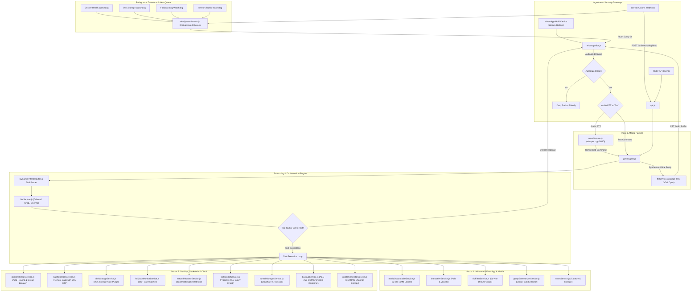

# D.A.V.I.S. (Digital Autonomous Voice & Intelligence System)

<p align="center">
  
</p>

<p align="center">
  <a href="LICENSE"></a>
  <a href="https://nodejs.org/"></a>
  <a href="https://ubuntu.com/"></a>
  <a href="tests/run_all.js"></a>
  <a href="tests/run_all.js"></a>
  <a href="https://github.com/WhiskeySockets/Baileys"></a>
</p>

Autonomous, self-hosted tactical AI assistant operating 24/7 on an Oracle Cloud VPS (Linux ARM64 / Ubuntu 22.04 LTS). D.A.V.I.S. combines the high-fidelity persona of a dedicated technical copilot with production-grade SysAdmin and DevOps autonomous control planes. It interfaces natively with WhatsApp via end-to-end WebSocket protocols, orchestrates tool calling across local and cloud LLMs, transcribes voice notes via hardware-accelerated Whisper, synthesizes native PTT voice responses, and enforces self-healing infrastructure automation.

---

## Technical Architecture



---

## Feature Matrix

### Core Capabilities
- **WhatsApp Multi-Device Engine:** Native WebSocket implementation via Baileys with Linked Identity Device (LID) resolution and stealth silent packet dropping for unauthorized senders.
- **Multi-Provider LLM Orchestration:** Dynamic provider switching (Ollama, Groq, OpenAI, DeepSeek) with intent-based tool pruning to eliminate hallucinations on smaller parameter models.
- **Whisper.cpp Voice Transcription:** Direct memory-pipe conversion from OGG/Opus to 16kHz PCM WAV with hardware vector acceleration (NEON SIMD on ARM64).
- **Headless Web Browsing:** Playwright Chromium automation with anti-detection flags, automated cookie banner removal, and content extraction fallback.
- **Persistent Second Brain:** Normalized JSON storage for facts, server credentials, personal preferences, and context-injected memory retrieval.

### Sector 1: Advanced WhatsApp, Audio & Media
- **Native PTT Voice Responses:** Generates high-definition audio responses via Edge-TTS encoded directly into native WhatsApp PTT voice notes (`audio/ogg; codecs=opus`).
- **Direct Media Downloader:** Downloads and post-processes video and audio from YouTube, Instagram, and TikTok with an automated multi-pass FFmpeg compression ladder (720p CRF 28 -> 480p CRF 32) strictly enforcing WhatsApp 16MB inline limits.
- **Interactive Messaging:** Dispatches native interactive WhatsApp polls with real-time vote collection and vCard 3.0 digital business cards.
- **VIP Mode & Do-Not-Disturb:** Filters external contacts with discreet auto-replies while whitelisting priority users and emergency keyword overrides (`urgente`, `socorro`, `hospital`).
- **Group Smart Summarizer:** Buffers high-volume group chats, tracks direct mentions, and synthesizes action items into structured bullet-point briefings.
- **Notes Capture:** Automatically transcribes and archives voice and text notes into categorized storage with timestamp metadata.

### Sector 2: DevOps, SysAdmin & Cloud Infrastructure
- **Autonomous Docker Auto-Healing:** Continuously monitors container lifecycles (`running`, `exited`, `restarting`) and attempts automated recovery via `docker restart` with flapping circuit-breaker protection.
- **Secure Remote Bash Console (2FA OTP):** Executes shell commands securely from chat. Critical and mutating commands (`reboot`, `rm`, `kill`, `pm2`) require temporary 4-to-6 digit OTP confirmation, protected by secret scrubbing and brute-force lockout.
- **Disk Storage Watchdog & Auto-Purge:** Monitors VPS filesystem capacity and triggers a multi-stage cleanup routine when storage exceeds 85% (`pm2 flush`, `apt-get clean`, `docker system prune -f`).
- **Fail2ban & Security Log Watchdog:** Scans SSH authentication logs and Fail2ban state, alerting in real time on IP bans with automatic deduplication.
- **CI/CD Telemetry Webhook:** Hardened endpoint (`POST /api/webhook/github`) verifying raw HMAC-SHA256 signatures, dispatching immediate alerts on failed build runs with commit and branch metadata.
- **Encrypted Automated Backups:** Generates AES-256-GCM encrypted backup containers (`DAVBAK01` binary format) with scrypt key derivation and tamper protection.
- **Proactive SSL Certificate Monitor:** Queries remote TLS sockets directly to extract x509 expiration dates, raising alerts 15 days before certificate expiry.
- **Network Traffic & Bandwidth Monitor:** Reads `/proc/net/dev` to calculate directional throughput (RX/TX), identifying abnormal spikes (>10 MB/s) with a 5-minute cooldown guard.
- **Dynamic Tunnel Manager:** Inspects telemetry and controls operational states for Cloudflare Tunnels (`cloudflared`) and Tailscale (`tailscale`).
- **High-Entropy Cryptographic Generator:** CSPRNG generator producing Shannon entropy passwords (>100 bits), numeric PINs, hex/base62 tokens, UUID v4, and raw AES keys with optional memory persistence.

---

## Security & Engineering Standards

- **Strict Zero Emojis Policy:** Absolute project-wide ban on emojis across all source code, comments, test suites, terminal logs, and outgoing WhatsApp messages.
- **Defense in Depth:** Constant-time cryptographic comparisons (`crypto.timingSafeEqual`) for HMAC verification, scrypt KDF for backups, and ephemeral OTP authorization.
- **Automated Test Coverage:** 100% test pass rate across 406 test cases in 141 suites using the Node.js native test runner (`node:test`, `node:assert/strict`).

---

## Quickstart

### 1. Requirements
- Node.js v20.x or higher
- Linux host (tested on Ubuntu 22.04 LTS AArch64 / x86_64)
- `ffmpeg` and `yt-dlp` installed and present in system PATH

### 2. Installation
```bash
git clone https://github.com/DCastellanos4/F.R.I.D.A.Y-bot.git
cd F.R.I.D.A.Y-bot
npm install
```

### 3. Configuration
Copy the configuration template:
```bash
cp .env.example .env
```

Configure required variables in `.env`:
```ini
# Authorized controller phone number (with country code, no +)
AUTHORIZED_USER_PHONE=34XXXXXXXXX

# Dedicated bot phone number
BOT_PHONE=34XXXXXXXXX

# LLM Provider: groq, openai, or ollama
LLM_PROVIDER=groq
OPENAI_API_KEY=gsk_your_api_key_here
OPENAI_BASE_URL=https://api.groq.com/openai/v1
OPENAI_MODEL=llama-3.3-70b-versatile

# REST API Port
PORT=3000

# Webhook Secret for GitHub Actions
GITHUB_WEBHOOK_SECRET=your_secure_webhook_secret_here

# Encryption Master Key for Automated Backups
BACKUP_PASSPHRASE=your_ultra_secure_backup_passphrase_here
```

### 4. Running the Test Suite
Execute the unified master test runner and zero-emoji compliance scanner:
```bash
node tests/run_all.js
```

### 5. WhatsApp Pairing & Service Startup
Pair WhatsApp via terminal code or QR:
```bash
./vincular-whatsapp.sh
```

Start production services under PM2:
```bash
pm2 start ecosystem.config.cjs
pm2 save
```

---

## Production PM2 Process Architecture

```bash
pm2 status
```
| ID | Process Name | Script | Role | Memory Target |
| :--- | :--- | :--- | :--- | :--- |
| `0` | `jarvis-api` | `api.js` | REST Endpoints, GitHub Webhook, System Health | ~70 MB |
| `1` | `jarvis-whatsapp` | `whatsappBot.js` | WebSocket Gateway, LLM Intent Engine, Watchdogs | ~130 MB |

---

## License

MIT License. See [LICENSE](LICENSE) for details.
