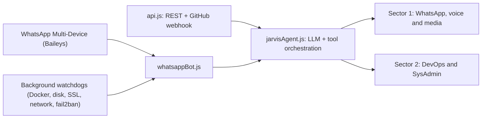

# D.A.V.I.S. (Digital Autonomous Voice & Intelligence System)

<p align="center">
  
</p>

<p align="center">
  <a href="LICENSE"></a>
  <a href="https://nodejs.org/"></a>
  <a href="https://ubuntu.com/"></a>
  <a href="tests/run_all.js"></a>
  <a href="https://github.com/WhiskeySockets/Baileys"></a>
</p>

Self-hosted personal AI assistant running 24/7 on an Oracle Cloud VPS under PM2. It pairs a sober J.A.R.V.I.S.-style persona (zero-emoji Spanish) with real SysAdmin and DevOps automation: WhatsApp multi-device chat over the native WebSocket protocol, multi-provider LLM tool calling, local Whisper.cpp voice transcription, Edge-TTS voice replies, and self-healing infrastructure watchdogs.

---

## Why This Project Exists

The goal was to turn a single WhatsApp chat into the control surface for one person's entire digital operations: messaging, reminders, a personal knowledge base, media downloads, and the administration of a real Linux server. Building it end to end meant owning problems that tutorials skip: an unofficial protocol integration, LLM tool-calling reliability on small models, safe execution of privileged commands from a chat channel, long-running process supervision, and a test suite that can prove regressions instead of hoping.

---

## Technical Architecture



---

## Engineering Decisions Worth Explaining

The choices a technical interview is likely to dig into, with their trade-offs:

- **Unofficial WhatsApp client (Baileys).** Full multi-device protocol access with no Business API costs, including Linked Identity Device (LID) resolution and silent packet dropping for unauthorized senders. Trade-off: not an official API, so the project carries the platform risk documented in Known Limitations.
- **Multi-provider LLM abstraction.** One `chatCompletion` interface over Ollama (local), Groq, OpenAI and DeepSeek, switchable via environment variables and injectable in tests, which keeps the whole reasoning engine testable offline.
- **Intent-based tool pruning.** Before each LLM call, a lightweight router classifies the message and prunes the tool list, because small-parameter local models hallucinate tool calls when handed the full catalog.
- **Defense against duplicated side effects.** Within a single request, the tool executor blocks an exact repeat of a side-effecting call, so a model retry cannot send the same WhatsApp message twice. It deliberately does not cover rephrased or later requests.
- **OTP interlock for dangerous commands.** Remote bash works from chat, but destructive commands (`reboot`, `rm`, `kill`, `pm2`) require a temporary 6-digit OTP (120s TTL, 3 attempts) with secret scrubbing and brute-force lockout.
- **Bounded conversation memory.** Long-term facts live in normalized JSON storage; conversation history is condensed on overflow with per-chat deduplication, and free-form memory never authorizes actions on its own: sends to third parties require a verified recipient in the current chat or a registered contact card.
- **Reusable procedures with explicit approval.** The agent can propose reusable multi-step skills, but each one activates only after the owner approves the exact content in chat (hash-bound, 30-minute TTL, one-shot); every skill step passes the same guards as a direct request.
- **Self-healing watchdogs with circuit breakers.** Docker auto-restart with flapping protection, disk auto-purge at 85%, fail2ban, SSL expiry and bandwidth monitors all flush through one deduplicated alert queue instead of spamming the chat.
- **Test strategy.** 804 tests across the suite with the Node.js native runner (no test-framework dependency): 802 passing, 2 voice tests skipping explicitly with a printed reason when `edge-tts` is unavailable. Integration tests drive the real WhatsApp entry handler with a fake socket and a fake LLM, and key regressions were verified by mutation. CI gates every push and PR to main (critical battery 100%, full suite >=95%) and deploys the tested SHA to the VPS over SSH as an isolated release.

---

## Feature Matrix

**Core:** WhatsApp multi-device engine (Baileys, LID resolution, silent drop of unauthorized senders) - multi-provider LLM orchestration with intent-based tool pruning - local Whisper.cpp transcription (OGG/Opus to 16kHz PCM via ffmpeg, no cloud speech API) - Edge-TTS replies as native PTT voice notes - headless Playwright browsing with anti-detection and cookie-banner removal - persistent second brain with indexed full-text history search.

**Sector 1 - WhatsApp, audio and media:** media downloader (YouTube, Instagram, TikTok) with a multi-pass FFmpeg compression ladder enforcing the 16MB inline limit - interactive polls and vCard 3.0 contacts - VIP do-not-disturb filter with emergency keyword override - group smart summarizer with action-item extraction - voice and text notes capture.

**Sector 2 - DevOps, SysAdmin and cloud:** Docker auto-healing with circuit breaker - secure remote bash console with 2FA OTP - disk watchdog with auto-purge at 85% - fail2ban and SSH log watchdog - GitHub webhook alerts (HMAC-SHA256 verified; wiring a workflow is a pending owner action) - AES-256-GCM encrypted backups (`DAVBAK01`, scrypt KDF) - proactive SSL expiry monitor - bandwidth spike monitor - Cloudflare Tunnel and Tailscale manager - CSPRNG generator for passwords, PINs, tokens and keys.

---

## Security & Engineering Standards

- **Strict zero-emoji policy** across source code, comments, tests, logs and outgoing messages.
- **Defense in depth:** constant-time HMAC comparison (`crypto.timingSafeEqual`), scrypt KDF for backups, ephemeral OTP for destructive commands, verified-recipient guard for outbound messages, chat-bound content-hashed approval for reusable skills.
- **Automated test coverage:** 802 of 804 tests passing (2 explicit skips) with `node:test`; nothing passes silently.

---

## Known Limitations

Written down because a portfolio should survive a skeptical read:

- **Voice path not covered in every environment.** Whisper and Edge-TTS depend on local binaries; where `edge-tts` is unavailable the 2 voice tests skip explicitly.
- **Rollback after a deploy cutover is a manual, separately approved decision** by design (reverting automatically could lose data written after the cutover), not an automated staged rollback.
- **GitHub failure alerts not yet wired.** The webhook endpoint is implemented and tested (HMAC-SHA256 verified), but no workflow posts `workflow_run` events to it yet; connecting one is a pending owner action.
- **Unofficial WhatsApp client.** Baileys carries an inherent risk of platform action; this is the accepted trade-off for full protocol access at zero API cost.
- **Single-operator design.** The authorization model assumes exactly one owner; there is no multi-user permission system.

---

## Quickstart

### 1. Requirements
- Node.js v20.x or higher (declared in `engines`)
- Linux host (developed for Ubuntu 22.04 LTS AArch64; service paths assume a Debian-like layout)
- `ffmpeg` and `yt-dlp` installed and present in system PATH
- Playwright Chromium browser: `npm run setup:browser` (required once per server; `npm ci`/`npm install` does not download browser binaries)

### 2. Installation
```bash
git clone https://github.com/DCastellanos4/F.R.I.D.A.Y-bot.git
cd F.R.I.D.A.Y-bot
npm install
npm run setup:browser
```

### 3. Configuration
Copy the configuration template:
```bash
cp .env.example .env
```

Configure required variables in `.env`:
```ini
# Authorized controller phone number (with country code, no +)
AUTHORIZED_USER_PHONE=34XXXXXXXXX

# Dedicated bot phone number
BOT_PHONE=34XXXXXXXXX

# LLM Provider: groq, openai, or ollama
LLM_PROVIDER=groq
OPENAI_API_KEY=gsk_your_api_key_here
OPENAI_BASE_URL=https://api.groq.com/openai/v1
OPENAI_MODEL=llama-3.3-70b-versatile

# REST API Port
PORT=3000

# Secret for the GitHub webhook endpoint
GITHUB_WEBHOOK_SECRET=your_secure_webhook_secret_here

# Encryption Master Key for Automated Backups
BACKUP_PASSPHRASE=your_ultra_secure_backup_passphrase_here
```

### 4. Running the Test Suite
Execute the unified master test runner and zero-emoji compliance scanner:
```bash
node tests/run_all.js
```

### 5. WhatsApp Pairing & Service Startup
Pair WhatsApp via terminal code or QR:
```bash
./vincular-whatsapp.sh
```

Start services under PM2:
```bash
pm2 start ecosystem.config.cjs
pm2 save
```

---


## PM2 Process Architecture

| Process | Script | Role | Memory Cap |
| :--- | :--- | :--- | :--- |
| `jarvis-api` | `api.js` | REST endpoints, GitHub webhook, system health | 500M |
| `jarvis-whatsapp` | `whatsappBot.js` | WebSocket gateway, LLM intent engine, watchdogs | 800M |

---

## Project Structure

```text
.
├── api.js                  # REST API entry point (PM2: jarvis-api)
├── whatsappBot.js          # WhatsApp bot entry point (PM2: jarvis-whatsapp)
├── chat.js                 # Interactive terminal client entry point
├── ecosystem.config.cjs    # PM2 process configuration
├── src/
│   ├── config/             # Environment loading and project path anchors
│   ├── core/               # Agent orchestration: jarvisAgent, intent router, LLM service, tools
│   ├── services/           # Application services (memory, history, notes, reminders, media, voice, TTS, ...)
│   ├── system/             # System-level services (bash console, backups, disk, tunnels)
│   └── monitors/           # Watchdogs (SSL, Docker, network, fail2ban, GitHub webhook)
├── scripts/                # Ad-hoc development and diagnostic scripts
└── tests/                  # Unified test suite (run_all.js) with harness and sector batteries
```

Data (`data/`) stays at the project root and is resolved through `src/config/paths.js`.

---

## License

MIT License. See [LICENSE](LICENSE) for details.
