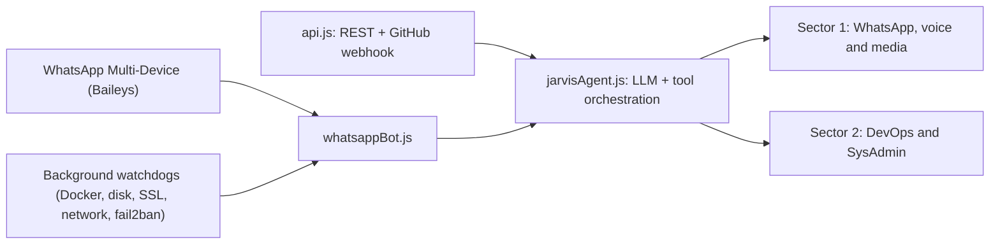
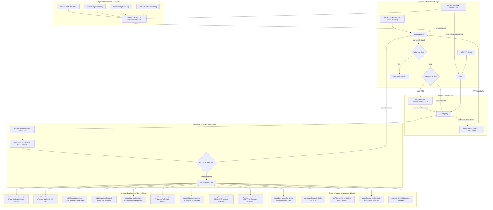

# D.A.V.I.S. (Digital Autonomous Voice & Intelligence System)

<p align="center">
  
</p>

<p align="center">
  <a href="LICENSE"></a>
  <a href="https://nodejs.org/"></a>
  <a href="https://ubuntu.com/"></a>
  <a href="tests/run_all.js"></a>
  <a href="tests/run_all.js"></a>
  <a href="https://github.com/WhiskeySockets/Baileys"></a>
</p>

Self-hosted personal AI assistant designed to run 24/7 and configured for PM2 process management; its owner reports hosting it on an Oracle Cloud VPS. D.A.V.I.S. pairs the persona of a dedicated technical copilot (inspired by J.A.R.V.I.S.) with hands-on SysAdmin and DevOps automation capabilities. It talks over WhatsApp through the native multi-device WebSocket protocol, orchestrates tool calling across local and cloud LLMs, transcribes voice notes locally with Whisper.cpp, answers with synthesized PTT voice notes, and ships self-healing infrastructure watchdogs (Docker auto-restart with circuit breaker, disk auto-purge, SSL and network monitors).

---

## Why This Project Exists

The goal was to turn a single WhatsApp chat into the control surface for one person's entire digital operations: messaging, reminders, a personal knowledge base, media downloads, and the administration of a real Linux server. Building it end to end meant owning problems that tutorials skip: an unofficial protocol integration, LLM tool-calling reliability on small models, safe execution of privileged commands from a chat channel, long-running process supervision, and a test suite that can prove regressions instead of hoping.

The persona layer (sober, dry-humored, zero-emoji Spanish) is deliberate: the assistant is a character with a consistent voice, defined in a single system prompt in `src/core/jarvisAgent.js`.

---

## Technical Architecture



<details>
<summary>Full architecture diagram (detailed)</summary>



</details>

---

## Engineering Decisions Worth Explaining

These are the choices a technical interview is likely to dig into, with their trade-offs:

- **Unofficial WhatsApp client (Baileys).** Full multi-device protocol access with no Business API costs, including Linked Identity Device (LID) resolution for modern accounts and silent packet dropping for unauthorized senders. Trade-off: it is not an official API, so the project carries the platform risk documented in Known Limitations.
- **Multi-provider LLM abstraction.** One `chatCompletion` interface over Ollama (local), Groq, OpenAI and DeepSeek. Providers are switchable via environment variables, and the interface is injectable in tests, which keeps the whole reasoning engine testable offline.
- **Intent-based tool pruning.** Before each LLM call, a lightweight router classifies the message and prunes the tool list, because small-parameter local models hallucinate tool calls when handed the full catalog.
- **Defense against duplicated side effects.** Within a single request, the tool executor blocks an exact repeat of a side-effecting call (same tool, same arguments), so a model retry in that request cannot send the same WhatsApp message twice. It deliberately does not cover rephrased requests or later requests.
- **OTP interlock for dangerous commands.** Remote bash works from chat, but destructive commands (`reboot`, `rm`, `kill`, `pm2`) require a one-time 6-digit code (120s TTL, 3 attempts) that only the owner's private channel can confirm. The assistant never sees the code.
- **Bounded conversation memory.** Per-chat history is persisted to disk and, on hitting the cap, older turns are condensed by the LLM into a rolling summary. Condensation is deduplicated per chat, merges messages that arrive mid-condensation, and never resurrects a history the user deleted meanwhile.
- **Self-healing watchdogs with circuit breakers.** Docker auto-restart with flapping protection, disk auto-purge at 85%, fail2ban, SSL expiry and bandwidth monitors all flush through one deduplicated alert queue instead of spamming the chat.
- **Test strategy.** 488 tests across 144 suites with the Node.js native runner (no test-framework dependency). Integration tests drive the real WhatsApp entry handler with a fake socket and a fake LLM, and the history-condensation regression was verified by mutation: deleting the wiring makes the test fail, which proves it guards the defect it claims to guard.

---

## Feature Matrix

### Core Capabilities
- **WhatsApp Multi-Device Engine:** Native WebSocket implementation via Baileys with Linked Identity Device (LID) resolution and stealth silent packet dropping for unauthorized senders.
- **Multi-Provider LLM Orchestration:** Dynamic provider switching (Ollama, Groq, OpenAI, DeepSeek) with intent-based tool pruning to reduce hallucinations on smaller parameter models.
- **Whisper.cpp Voice Transcription:** Fully local transcription via the whisper.cpp CLI: OGG/Opus from WhatsApp converted in memory to 16kHz mono PCM WAV with ffmpeg, no cloud speech API.
- **Headless Web Browsing:** Playwright Chromium automation with anti-detection flags, automated cookie banner removal, and content extraction fallback.
- **Persistent Second Brain:** Normalized JSON storage for facts, personal preferences, and context-injected memory retrieval.

### Sector 1: Advanced WhatsApp, Audio & Media
- **Native PTT Voice Responses:** Generates audio responses via Edge-TTS encoded directly into native WhatsApp PTT voice notes (`audio/ogg; codecs=opus`).
- **Direct Media Downloader:** Downloads and post-processes video and audio from YouTube, Instagram, and TikTok with an automated multi-pass FFmpeg compression ladder (720p CRF 28 -> 480p CRF 32) strictly enforcing WhatsApp 16MB inline limits.
- **Interactive Messaging:** Dispatches native interactive WhatsApp polls with real-time vote collection and vCard 3.0 digital business cards.
- **VIP Mode & Do-Not-Disturb:** Filters external contacts with discreet auto-replies while whitelisting priority users and emergency keyword overrides (`urgente`, `socorro`, `hospital`).
- **Group Smart Summarizer:** Buffers high-volume group chats, tracks direct mentions, and synthesizes action items into structured bullet-point briefings.
- **Notes Capture:** Automatically transcribes and archives voice and text notes into categorized storage with timestamp metadata.

### Sector 2: DevOps, SysAdmin & Cloud Infrastructure
- **Autonomous Docker Auto-Healing:** Continuously monitors container lifecycles (`running`, `exited`, `restarting`) and attempts automated recovery via `docker restart` with flapping circuit-breaker protection.
- **Secure Remote Bash Console (2FA OTP):** Executes shell commands securely from chat. Critical and mutating commands (`reboot`, `rm`, `kill`, `pm2`) require a temporary 6-digit OTP (120s TTL, 3 attempts), protected by secret scrubbing and brute-force lockout.
- **Disk Storage Watchdog & Auto-Purge:** Monitors VPS filesystem capacity and triggers a multi-stage cleanup routine when storage exceeds 85% (`pm2 flush`, `apt-get clean`, `docker system prune -f`).
- **Fail2ban & Security Log Watchdog:** Scans SSH authentication logs and Fail2ban state, alerting in real time on IP bans with automatic deduplication.
- **GitHub Webhook Alerts:** Hardened endpoint (`POST /api/webhook/github`) verifying raw HMAC-SHA256 signatures (`crypto.timingSafeEqual`), dispatching chat alerts when a `workflow_run` event reports failure, with repo, branch and commit metadata. The endpoint is implemented and tested; connecting it to a GitHub workflow is a pending owner action (see Known Limitations).
- **Encrypted Automated Backups:** Generates AES-256-GCM encrypted backup containers (`DAVBAK01` binary format) with scrypt key derivation and tamper protection.
- **Proactive SSL Certificate Monitor:** Queries remote TLS sockets directly to extract x509 expiration dates, raising alerts 15 days before certificate expiry.
- **Network Traffic & Bandwidth Monitor:** Reads `/proc/net/dev` to calculate directional throughput (RX/TX), identifying abnormal spikes (>10 MB/s) with a 5-minute cooldown guard.
- **Dynamic Tunnel Manager:** Inspects telemetry and controls operational states for Cloudflare Tunnels (`cloudflared`) and Tailscale (`tailscale`).
- **High-Entropy Cryptographic Generator:** CSPRNG generator producing Shannon entropy passwords (>100 bits), numeric PINs, hex/base62 tokens, UUID v4, and raw AES keys with optional memory persistence.

---

## Security & Engineering Standards

- **Strict Zero Emojis Policy:** Absolute project-wide ban on emojis across all source code, comments, test suites, terminal logs, and outgoing WhatsApp messages.
- **Defense in Depth:** Constant-time cryptographic comparisons (`crypto.timingSafeEqual`) for HMAC verification, scrypt KDF for backups, and ephemeral OTP authorization for destructive commands.
- **Automated Test Coverage:** 486 of 488 tests passing across 144 suites with the Node.js native test runner (`node:test`, `node:assert/strict`). The remaining 2 voice tests skip explicitly, with a printed reason, when `edge-tts` is not installed; they never pass silently.

---

## Known Limitations

Written down because a portfolio should survive a skeptical read:

- **No CI yet.** The suite runs on demand (`node tests/run_all.js`); nothing gates merges automatically.
- **Voice path not covered in every environment.** Whisper transcription and Edge-TTS replies depend on local binaries (`whisper-cli`, `edge-tts`) installed on the host; where `edge-tts` is unavailable the 2 voice tests skip explicitly, so voice behavior is not continuously verified.
- **Manual deployment.** Shipping to the Oracle VPS is a manual `git pull` + `pm2 restart`; there is no automated pipeline or staged rollback.
- **Unofficial WhatsApp client.** Baileys is not an official API; accounts using it carry an inherent risk of platform action. This is the accepted trade-off for full protocol access at zero API cost.
- **Single-operator design.** The authorization model assumes exactly one owner; there is no multi-user permission system.

---

## Quickstart

### 1. Requirements
- Node.js v20.x or higher (declared in `engines`)
- Linux host (developed for Ubuntu 22.04 LTS AArch64; service paths assume a Debian-like layout)
- `ffmpeg` and `yt-dlp` installed and present in system PATH
- Playwright Chromium browser: `npm run setup:browser` (required once per server; `npm ci`/`npm install` does not download browser binaries)

### 2. Installation
```bash
git clone https://github.com/DCastellanos4/F.R.I.D.A.Y-bot.git
cd F.R.I.D.A.Y-bot
npm install
npm run setup:browser
```

### 3. Configuration
Copy the configuration template:
```bash
cp .env.example .env
```

Configure required variables in `.env`:
```ini
# Authorized controller phone number (with country code, no +)
AUTHORIZED_USER_PHONE=34XXXXXXXXX

# Dedicated bot phone number
BOT_PHONE=34XXXXXXXXX

# LLM Provider: groq, openai, or ollama
LLM_PROVIDER=groq
OPENAI_API_KEY=gsk_your_api_key_here
OPENAI_BASE_URL=https://api.groq.com/openai/v1
OPENAI_MODEL=llama-3.3-70b-versatile

# REST API Port
PORT=3000

# Secret for the GitHub webhook endpoint
GITHUB_WEBHOOK_SECRET=your_secure_webhook_secret_here

# Encryption Master Key for Automated Backups
BACKUP_PASSPHRASE=your_ultra_secure_backup_passphrase_here
```

### 4. Running the Test Suite
Execute the unified master test runner and zero-emoji compliance scanner:
```bash
node tests/run_all.js
```

### 5. WhatsApp Pairing & Service Startup
Pair WhatsApp via terminal code or QR:
```bash
./vincular-whatsapp.sh
```

Start services under PM2:
```bash
pm2 start ecosystem.config.cjs
pm2 save
```

---

## PM2 Process Architecture

```bash
pm2 status
```
| ID | Process Name | Script | Role | PM2 Memory Cap |
| :--- | :--- | :--- | :--- | :--- |
| `0` | `jarvis-api` | `api.js` | REST Endpoints, GitHub Webhook, System Health | `max_memory_restart` 500M |
| `1` | `jarvis-whatsapp` | `whatsappBot.js` | WebSocket Gateway, LLM Intent Engine, Watchdogs | `max_memory_restart` 800M |

---

## Project Structure

```text
.
├── api.js                  # REST API entry point (PM2: jarvis-api)
├── whatsappBot.js          # WhatsApp bot entry point (PM2: jarvis-whatsapp)
├── chat.js                 # Interactive terminal client entry point
├── ecosystem.config.cjs    # PM2 process configuration
├── src/
│   ├── config/             # Environment loading (config.js) and project path anchors (paths.js)
│   ├── core/               # Agent orchestration: jarvisAgent, intent router, LLM service, tools, interactive service
│   ├── services/           # Application services: memory, history, notes, reminders, scheduled messages,
│   │                       # confirmations, media, voice, TTS, browser, weather, news, summarizers, briefing
│   ├── system/             # System-level services: command runner, bash console, backups, disk storage, tunnels
│   └── monitors/           # Watchdogs and monitors: sniper, proactive alerts, SSL, Docker, network, fail2ban, GitHub webhook
├── scripts/                # Ad-hoc development and diagnostic scripts
└── tests/                  # Unified test suite (run_all.js) with harness and sector batteries
```

Data (`data/`) stays at the project root and is resolved through `src/config/paths.js`, so modules can live in subfolders without depending on their own location. Entry points and PM2 script names are unchanged.

---

## License

MIT License. See [LICENSE](LICENSE) for details.
