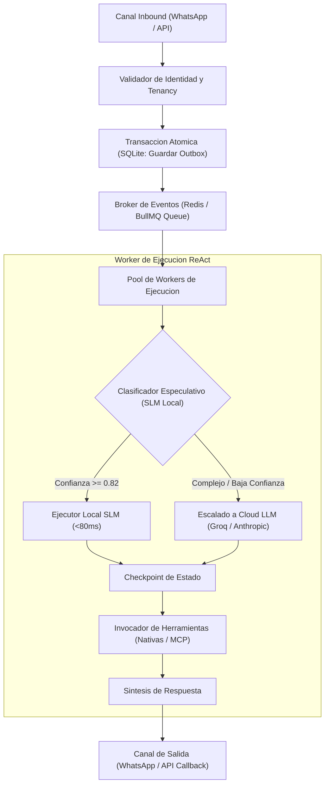
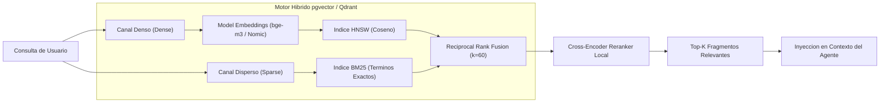

# ESPECIFICACION DE REQUISITOS DEL SISTEMA (ERS)
## D.A.V.I.S. NEXT LEVEL: ARQUITECTURA DISTRIBUIDA, INFERENCIA ESPECULATIVA Y MCP
### Documento de Ingenieria de Software y Arquitectura de Sistemas
### Version: 3.0.0-PROD
### Fecha: Noviembre 2026
### Politica de Estilo: Estricta Politica de Cero Emojis

---

## 1. INTRODUCCION Y ALCANCE

### 1.1 Proposito
El presente documento define la Especificacion de Requisitos del Sistema (ERS) para la evolucion arquitectonica de D.A.V.I.S. hacia un estandar de madurez industrial de nivel Staff/Principal Engineer, orientado a la comercializacion en formato SaaS B2B/B2C y a la superacion de auditorias tecnicas de alta exigencia.

### 1.2 Alcance del Sistema
D.A.V.I.S. evoluciona de un agente reactivo acoplado a un sistema distribuido tolerante a fallos, asincrono, con inferencia especulativa multinivel, persistencia vectorial industrial y desacoplamiento total de herramientas mediante estandares abiertos (Model Context Protocol).

### 1.3 Estado Base del Sistema (Baseline Auditado)
El sistema actual cuenta con:
* **Pruebas y Verificacion**: 1.198 tests ejecutados, 1.193 superados (0 fallos, 5 skips controlados de entorno offline, exit code 0). Cero emojis en codigo y logs.
* **Arquitectura Hexagonal**: Puertos de entrada (`InboundMessage`, canales WhatsApp y API) y salida desacoplados del nucleo (`src/composition/container.js`).
* **Persistencia Transaccional**: SQLite con modo Write-Ahead Logging (WAL), migraciones versionadas (001 a 004) y patron Repository.
* **Multi-Tenancy y RBAC**: Separacion Propietario vs Tenants sinteticos, compuerta fail-closed, permisos durables revocables y aislamiento de memoria.
* **Gobernanza de Uso**: Libro de medicion de tokens (`usageLedgerService.js`), cuotas por tenant y reserva de presupuesto TPM para Groq (`groqBudget.js`).
* **Observabilidad**: Spans OpenTelemetry, exportador `/metrics` de Prometheus con etiquetas de catalogo cerrado, panel Grafana y renderer en Docker.

---

## 2. REQUISITOS FUNCIONALES (RF)

### RF-01: Desacoplamiento Asincrono con Transactional Outbox y Colas Redis/BullMQ
* **Descripcion**: Desacoplar por completo el receptor de mensajes de los canales de comunicacion (WhatsApp/API) del motor de razonamiento del agente.
* **Entradas**: Mensaje inbound validado por el adaptador del canal.
* **Procesamiento**:
  1. Escritura inmediata en la tabla `outbox_events` de SQLite en una transaccion atomica (< 3 ms).
  2. Emision de un evento al broker Redis a traves de una cola duradera gestionada por BullMQ.
  3. Despacho hacia un pool de workers aislados que ejecutan el bucle ReAct.
  4. Puntos de control (checkpoints) persistidos tras cada ronda de herramientas: si el proceso worker se interrumpe o reinicia, la ejecucion se reanuda desde el ultimo punto de control sin repetir llamadas a herramientas con efectos secundarios.
* **Salidas**: Evento de respuesta encolado en `channel_responses` y entregado al adaptador de salida correspondiente.

### RF-02: Enrutador de Inferencia Especulativa Hibrida (SLM Local -> Cloud Escalation)
* **Descripcion**: Implementar un sistema de inferencia jerarquica en dos niveles para optimizar el coste de operacion, la latencia y la resiliencia offline.
* **Nivel 1 (Edge / Local SLM)**:
  - Motor de ejecucion local en CPU/GPU del VPS mediante ONNX Runtime o servidor Ollama embebido.
  - Modelo objetivo: Familia Qwen 2.5 (1.5B / 3B) o Llama 3.2 (3B).
  - Tareas asignadas: Clasificacion de intenciones, extraccion determinista de argumentos JSON para herramientas simples (clima, transporte, notas, fechas, compras) y generacion de respuestas conversacionales estandar.
  - Criterio de exito local: Si la puntuacion de confianza es >= 0.82 y la validacion de esquema JSON es valida, se ejecuta localmente en < 80 ms con coste marginal 0.
* **Nivel 2 (Cloud LLM Escalation)**:
  - Solo si el SLM local marca ambiguedad (< 0.82), solicita desambiguacion multi-herramienta, requiere tareas complejas de programacion/depuracion o el tenant cuenta con tier enterprise.
  - Escalado hacia Groq (`llama-3.3-70b-versatile`) o proveedores cloud de respaldo (OpenAI/Anthropic/Gemini).
* **Salidas**: Decision de ejecucion trazada en OpenTelemetry con metrica de ahorro de coste (`tokens_saved_by_local_slm`).

### RF-03: Motor RAG Vectorial Industrial (Hibrido Denso + Disperso con RRF y Cross-Encoder)
* **Descripcion**: Sustituir el motor TF-IDF en memoria por una arquitectura de base de datos vectorial escalable con recuperacion hibrida.
* **Almacenamiento**:
  - Motor embebido o contenedor: `pgvector` en PostgreSQL o `Qdrant` con persistencia en disco SSD.
  - Aislamiento multi-tenant nativo por clave de particionado (`tenant_id`).
* **Canal Denso (Dense)**:
  - Embeddings de alta dimensionalidad (768d o 1024d) generados localmente o via API (modelo `bge-m3` o `nomic-embed-text-v1.5`).
* **Canal Disperso (Sparse)**:
  - Motor BM25 optimizado para recuperacion de terminos exactos, IDs, direcciones IP, codigos y nombres propios.
* **Fusion y Reranking**:
  - Algoritmo Reciprocal Rank Fusion (RRF, factor k=60) para combinar las listas de candidatos denso y disperso.
  - Reranker secundario ligero tipo Cross-Encoder (`bge-reranker-base`) para filtrar los mejores K fragmentos antes de la inyeccion en la ventana de contexto.
* **Salidas**: Fragmentos ordenados con score de relevancia calibrado [0.0 - 1.0].

### RF-04: Infraestructura Model Context Protocol (MCP Client & Host)
* **Descripcion**: Estandarizar la declaracion, descubrimiento y ejecucion de herramientas externas adoptando la especificacion abierta Model Context Protocol (MCP).
* **Componente MCP Client**:
  - D.A.V.I.S. actua como cliente MCP nativo.
  - Conecta servidores MCP externos a traves de transporte `stdio` o `Server-Sent Events (SSE)`.
  - Permite descubrir dinamicamente capacidades externas (ej: servidores MCP de Jira, GitHub, Stripe, PostgreSQL, Notion, Docker) sin modificar codigo fuente del nucleo.
* **Componente MCP Host**:
  - D.A.V.I.S. expone sus propias herramientas auditadas (calendario, gastos, finanzas, transporte Renfe) como servidor MCP para que otros agentes o sistemas corporativos puedan consumirlas de forma segura.
* **Seguridad y Sandboxing**:
  - Cada conexion MCP externa opera en un proceso hijo restringido con limites de CPU/memoria y politicas RBAC asignadas por tenant.

### RF-05: Pipeline de Voz y Audio en Tiempo Real (Full-Duplex Streaming)
* **Descripcion**: Migrar del esquema monolitico de audio (fichero ogg -> Whisper batch -> LLM -> TTS -> ogg) a una arquitectura continua de baja latencia.
* **Componentes**:
  - Detector de actividad vocal en tiempo real (Voice Activity Detection - VAD con Silero VAD).
  - Streaming de entrada via WebSockets hacia modelos STT (Whisper streaming / Deepgram).
  - Mecanismo de interrupcion interactiva (Barge-in): si el usuario empieza a hablar mientras el asistente emite audio, se corta inmediatamente la reproduccion en curso y se reinicia el pipeline.
* **Latencia objetivo**: Tiempo transcurrido entre fin de voz y primer chunk de audio < 600 ms.

---

## 3. REQUISITOS NO FUNCIONALES (RNF)

### RNF-01: Fiabilidad y Tolerancia a Fallos (Durable Execution)
* El sistema debe garantizar que ningun mensaje aceptado por el puerto de entrada sea descartado o perdido ante caidas del proceso Node.js, reinicios de PM2 o reinicios del servidor anfitrion.
* Las tareas de larga duracion deben persistir su progreso de forma atomica tras cada transicion de estado.
* Objetivo de disponibilidad: 99.9% de uptime para recepcion de mensajes.

### RNF-02: Rendimiento y Latencia
* Consultas simples resueltas por SLM local: Latencia P95 <= 250 ms.
* Consultas con enrutado cloud de 1 ronda de herramientas: Latencia P95 <= 1.200 ms.
* Tiempo de arranque del contenedor/proceso: <= 4.000 ms.
* Rendimiento de base de datos relacional SQLite/Postgres: >= 1.000 operaciones de lectura/s en modo concurrente.

### RNF-03: Eficiencia de Costes e Inferencia
* Reduccion demostrable de coste por usuario activo mensual (MAU) en al menos un 75% respecto al esquema monolitico cloud.
* Presupuesto de tokens acotado por tenant con fail-closed automatico sin consumo fantasma.

### RNF-04: Seguridad, Privacidad y Gobernanza de Datos
* **Aislamiento Cero-Fugas**: Ningun tenant podra leer, modificar ni inferir datos pertenecientes a otro tenant o al propietario.
* **Anonimizacion PII Pre-LLM**: Deteccion automatica y enmascaramiento de datos personales sensibles (IBAN, DNI, tarjetas de credito, telefonos personales no verificados) antes de su envio a proveedores de inferencia de terceros.
* **Auditoria Inmutable**: Registro firmado criptograficamente de cada invocacion de herramienta con hash SHA256 de argumentos y respuestas.
* **Estricta Politica de Cero Emojis**: Ningun modulo del sistema, mensaje saliente, log de depuracion, metrica o informe podra contener caracteres emoji.

---

## 4. ARQUITECTURA DEL SISTEMA Y DIAGRAMAS

### 4.1 Flujo Asincrono Dirigido por Eventos (Outbox Pattern)



### 4.2 Arquitectura del Motor Vectorial Hibrido (RAG Industrial)



### 4.3 Integracion con Model Context Protocol (MCP)

```mermaid
flowchart TD
    DAVIS["D.A.V.I.S. Core Engine"]
    
    subgraph MCP_Architecture ["Arquitectura de Herramientas MCP"]
        DAVIS -->|MCP Client Transport (stdio / SSE)| M1["Servidor MCP GitHub / DevOps"]
        DAVIS -->|MCP Client Transport (stdio / SSE)| M2["Servidor MCP Postgres / Data"]
        DAVIS -->|MCP Client Transport (stdio / SSE)| M3["Servidor MCP Servicios de Terceros"]
        
        DAVIS -.->|MCP Host Server| EXT["Sistemas Corporativos Externos"]
    end
```

---

## 5. PLAN DE IMPLEMENTACION POR FASES

### Fase 1: Desacoplamiento Asincrono y Transactional Outbox
* **Duracion estimada**: Semana 1 - 2.
* **Entregables**:
  - Migracion de base de datos: tabla `outbox_events` y `job_checkpoints`.
  - Integracion de BullMQ y conexion Redis persistente.
  - Adaptacion de `whatsappInboundAdapter.js` para retorno HTTP/Ack en < 5ms.
  - Bateria de pruebas de caida y recuperacion forzada en ejecucion.

### Fase 2: Inferencia Especulativa y SLM Local
* **Duracion estimada**: Semana 3 - 4.
* **Entregables**:
  - Servicio `localSlmInferenceService.js` con soporte ONNX Runtime / Ollama API.
  - Enrutador especulativo con calibracion de confianza y fallback automatico a Groq.
  - Metricas de telemetria de ahorro de tokens y tiempos de inferencia.
  - 100% compatibilidad con contratos de herramientas existentes.

### Fase 3: RAG Hibrido y Almacenamiento Vectorial Industrial
* **Duracion estimada**: Semana 5 - 6.
* **Entregables**:
  - Contenedor / extension `pgvector` o `Qdrant` integrado en compose de despliegue.
  - Pipeline de indexacion hibrida (Dense + BM25) con particionado por tenant.
  - Re-clasificador Cross-Encoder local.
  - Migracion transparente de `knowledge_vectors.json` al nuevo motor.

### Fase 4: Protocolo MCP y Preparacion Comercial
* **Duracion estimada**: Semana 7 - 8.
* **Entregables**:
  - Implementacion de cliente MCP compatible con especificacion oficial 2024-11-05.
  - Aislamiento en sandbox de servidores MCP externos.
  - Auditoria de seguridad de endpoints y emision de paquete de distribucion SaaS.

---

## 6. CRITERIOS DE ACEPTACION DEL SISTEMA

1. **Test Suite Verde**: El 100% de la suite de pruebas unitarias, de integracion y de regresion debe ejecutarse limpiamente con codigo de salida 0.
2. **Cero Perdida de Mensajes**: En una prueba de estres con parada intempestiva del proceso Node.js durante una llamada a LLM, el mensaje debe ser reprocesado y completado al reiniciar el servicio sin duplicar efectos.
3. **P95 Latency SLA**: Al menos el 60% de las consultas cotidianas (clima, recordatorios, consultas directas) deben ser resueltas en < 200 ms mediante inferencia local.
4. **Cumplimiento de Estilo**: Cero emojis verificados en cualquier archivo fuente, test, log o salida del sistema.
