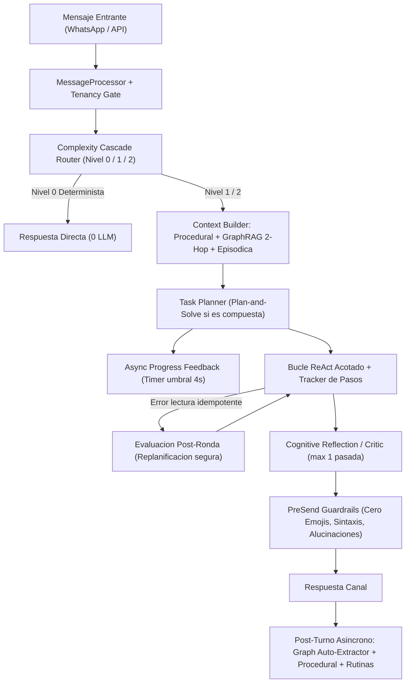

# ESPECIFICACION TECNICA DE EVOLUCION COGNITIVA (ERS v4.0)
## D.A.V.I.S. Inteligencia Adaptativa, Planificacion y Metacognicion
### Version: 4.0.0-COG
### Fecha: Noviembre 2026
### Politica de Estilo: Estricta Politica de Cero Emojis

---

## 1. INTRODUCCION Y ALCANCE

### 1.1 Proposito
Este documento especifica los siete pilares cognitivos para evolucionar el nucleo de razonamiento de D.A.V.I.S. (`src/core/jarvisAgent.js` y capa de servicios) desde un bucle ReAct lineal hacia una arquitectura cognitiva adaptativa con aprendizaje procedural, planificacion multi-paso, autocritica acotada, enrutado por complejidad, GraphRAG de 2 saltos, feedback de latencia y proactividad basada en rutinas.

### 1.2 Alcance y Exclusiones Explicitas
- **Incluido en el alcance:** Nucleo cognitivo, memoria procedural y de rutinas en SQLite, enrutado en cascada, extractor y traversal de grafo, planificador de tareas compuestas, modulo de reflexion/critica, feedback asincrono de progreso en canales e integracion en `dailyBriefing.js`.
- **Excluido por alcance operativo actual:** Integraciones adicionales de hardware/domotica y nuevos monitores de vigilancia de infraestructura VPS.
- **Compatibilidad obligatoria:** Todas las mejoras son aditivas y conservan intactos la arquitectura hexagonal, los guardarrailes pre-envio, la politica de cero emojis, el aislamiento multi-tenant (`tenant_id`) y las pruebas existentes.

---

## 2. ARQUITECTURA COGNITIVA GLOBAL



---

## 3. REQUISITOS FUNCIONALES COGNITIVOS

### 3.1 RF-COG-01 (Tarea 1): Memoria Procedural y Aprendizaje de Correcciones
* **Modulo:** `src/services/proceduralMemoryService.js`
* **Persistencia:** Tabla `memoria_procedural` en SQLite (Migracion 016), aislada por `tenant_id`.
* **Problema resuelto:** Las memorias actuales solo almacenan hechos declarativos. Las preferencias operativas o correcciones de estilo/proceso del usuario se pierden al rotar la ventana de 12 mensajes.
* **Comportamiento:**
  1. **Deteccion automatica:** Analiza mensajes entrantes buscando directrices operativas duraderas ("de ahora en adelante...", "siempre que te pida...", "prefiero que...", "no vuelvas a...", "cuando hagas X haz Y") mediante reglas deterministicas sin coste LLM extra.
  2. **Gestion explicita:** Herramientas `guardar_regla_procedural`, `listar_reglas_procedurales` y `eliminar_regla_procedural`.
  3. **Inyeccion selectiva en contexto:** Recupera reglas activas aplicables al dominio/intencion actual (o globales) y las anade como `[PREFERENCIAS OPERATIVAS DEL USUARIO]` al system prompt.
  4. **Invariante de seguridad (Fail-Closed):** Ninguna regla procedural almacenada o detectada puede desactivar `NUCLEO_PERSONALIDAD`, confirmaciones OTP, limites RBAC, guardarrailes pre-envio ni verificacion de destinatarios; las reglas que intenten eludir restricciones de seguridad se rechazan en el guardado y en la lectura.

### 3.2 RF-COG-02 (Tarea 2): Enrutado Dinamico de Modelos por Complejidad (Cascade Routing)
* **Modulo:** `src/core/complexityCascadeRouter.js`
* **Problema resuelto:** Tratar todas las consultas con el mismo presupuesto y modelo desperdicia cuota en turnos simples y limita el margen de razonamiento en turnos complejos.
* **Niveles de clasificacion:**
  - **Nivel 0 (Determinista, 0 LLM):** Consultas cubiertas por rutas deterministicas verificadas (salidas GTFS, calendario hoy, autoservicio/cuota).
  - **Nivel 1 (Rapido / Estructurado):** Intencion unica simple, recordatorios, clima, notas, gastos unitarios, charla conversacional. Puede seleccionar `DAVIS_MODELO_NIVEL1` si esta configurado.
  - **Nivel 2 (Razonamiento Profundo):** Especialista `coder`, peticiones compuestas multi-paso (>=2 intenciones), analisis de documentos/CV, o rondas ReAct posteriores a fallo de herramienta. Puede seleccionar `DAVIS_MODELO_NIVEL2` y ampliar `num_predict` respetando `groqBudget`.
* **Retrocompatibilidad:** Si no se definen variables `DAVIS_MODELO_NIVEL1` / `DAVIS_MODELO_NIVEL2`, mantiene exactamente el modelo principal y failover vigentes (`routerLLM.js`), registrando siempre `traza.complejidad = { nivel, razon, categoria }` para observabilidad y `explicar_recorrido`.

### 3.3 RF-COG-03 (Tarea 3): GraphRAG Local Automatico (Entity Linking 2-Hop)
* **Modulos:** `src/services/knowledgeGraphAutoExtractor.js` y `src/services/graphMemoryService.js`
* **Problema resuelto:** La extraccion actual cubre familia, trabajo basico y viajes, pero omite proyectos, estudios, examenes, entregas, candidaturas y suscripciones; ademas, la consulta al grafo es de un solo salto literal.
* **Comportamiento:**
  1. **Extractor ampliado:** Nuevos patrones para `proyecto` (`trabaja_en_proyecto`, `usa_tecnologia`), `estudio` (`estudia`, `tiene_examen`, `tiene_entrega`), `empleo` (`candidatura_en`, `entrevista_en`) y `finanzas` (`suscrito_a`), manteniendo aislamiento estricto por `tenant_id`.
  2. **Traversal 2-Hop acotado:** Nueva funcion `recuperarSubgrafoContextual(consulta, { store, rutaArchivo, tenantId, maxHops = 2, maxAristas = 15 })` mediante busqueda en anchura (BFS) desde las entidades detectadas en el mensaje y sus alias normalizados (`usuario`/`david`), acotada en longitud para no inflar el presupuesto de tokens.

### 3.4 RF-COG-04 (Tarea 4): Planificacion de Tareas Compuestas (Plan-and-Solve)
* **Modulo:** `src/services/taskPlannerService.js`
* **Problema resuelto:** Ante peticiones compuestas con multiples objetivos enlazados, el modelo tiende a ejecutar el primer paso y cerrar la respuesta olvidando los restantes.
* **Comportamiento:**
  1. **Deteccion estructural:** `detectarPeticionCompuesta(mensaje, intenciones)` detecta conectores secuenciales ("y luego", "despues", "ademas"), enumeraciones o multiples verbos de accion entre dominios distintos.
  2. **Descomposicion y tracker:** `generarPlanEstructurado` genera sub-objetivos ordenados `{ id, descripcion, herramientaSugerida, estado }`.
  3. **Seguimiento en ReAct:** Tras cada ronda de herramientas en `jarvisAgent.js`, marca completados los pasos cuyas herramientas tuvieron exito; si el modelo intenta cerrar la respuesta quedando sub-objetivos pendientes sin ejecutar (y quedan rondas disponibles), inyecta una directiva breve indicando el paso pendiente y registra `traza.planEjecucion`.

### 3.5 RF-COG-05 (Tarea 5): Metacognicion y Bucle de Reflexion (Self-Refine / Critic)
* **Modulo:** `src/services/cognitiveReflectionService.js`
* **Problema resuelto:** Si una herramienta devuelve datos incompletos o el borrador sintetizado omite parte de la pregunta o contradice el resultado observado, se entrega sin revision.
* **Comportamiento:**
  1. **Evaluacion post-ronda:** `evaluarResultadoRonda` detecta errores recuperables en herramientas de solo lectura (`HERRAMIENTAS_IDEMPOTENTES`) o resultados vacios cuando existe una herramienta alternativa en el catalogo activo, sugiriendo replanificar en la siguiente ronda.
  2. **Critica pre-envio acotada:** `reflexionarYCriticarRespuesta` solo se activa en turnos complejos (>=2 llamadas a herramientas o errores parciales durante el bucle). Verifica consistencia entre pregunta, observaciones reales y borrador; si detecta omision grave o contradiccion, realiza como maximo 1 pasada de refinamiento textual (`maxRevisiones = 1`).
  3. **Regla estricta de no-mutacion:** La reflexion nunca dispara ni repite herramientas con efectos secundarios.

### 3.6 RF-COG-06 (Tarea 6): Ejecucion Desacoplada con Feedback de Progreso
* **Modulo:** `src/services/asyncProgressFeedbackService.js` + hook en `whatsappBot.js` y `jarvisAgent.js`
* **Problema resuelto:** En modo sincrono, operaciones compuestas o de red lentas dejan al usuario esperando varios segundos sin confirmacion visual mas alla del indicador efimero `composing`.
* **Comportamiento:**
  1. **Estimacion previa:** `estimarDuracionMs({ intenciones, herramientas, esPlanCompuesto, complejidad })` estima si la peticion superara `DAVIS_PROGRESS_ACK_MS` (por defecto `4000` ms).
  2. **Acuse tactico unico:** Si la ejecucion sigue en curso al vencer el temporizador, invoca `onProgresoTactico(mensaje)` una sola vez (mensaje conciso, sin emojis, contextualizado al tipo de tarea). Si responde antes del umbral, cancela el timer limpiamente en `finally`.
  3. **Restricciones de canal:** Respeta horario nocturno (`quietHoursService`), modo de voz (`respuestaVoz`) y modo `DAVIS_ASYNC_PIPELINE=1` evitando mensajes redundantes.

### 3.7 RF-COG-07 (Tarea 7): Proactividad Predictiva Basada en Rutinas
* **Modulo:** `src/services/habitPatternPredictorService.js` + integracion en `dailyBriefing.js`
* **Persistencia:** Tabla `rutinas_actividad` en SQLite (Migracion 016), aislada por `tenant_id`.
* **Privacidad:** Almacena exclusivamente metadatos estadisticos (`tenant_id`, `dia_semana`, `franja_horaria`, `intencion`, `herramienta`, `conteo`, `ultima_vez`), nunca el contenido de los mensajes.
* **Comportamiento:**
  1. **Registro continuo:** Registra cada interaccion real agrupada por dia de la semana (0-6) y franja horaria de 2 horas (ej. `06-08`, `08-10`).
  2. **Prediccion con umbral:** `predecirNecesidades({ tenantId, fecha, umbralMinimo })` identifica rutinas consolidadas por frecuencia y recencia.
  3. **Integracion y transparencia:** Anade seccion `[SUGERENCIAS PREDICTIVAS DE RUTINA]` en `dailyBriefing.js` cuando hay predicciones activas para el dia en curso, y expone la herramienta de solo lectura `consultar_rutinas_aprendidas` para que David pueda inspeccionar lo aprendido.

---

## 4. ESQUEMA DE DATOS SQLITE (MIGRACION 016)

```sql
CREATE TABLE IF NOT EXISTS memoria_procedural (
  id TEXT NOT NULL,
  tenant_id TEXT NOT NULL DEFAULT 'propietario',
  dominio TEXT NOT NULL DEFAULT 'general',
  disparador TEXT NOT NULL DEFAULT '',
  regla TEXT NOT NULL,
  origen TEXT NOT NULL DEFAULT 'auto',
  confianza REAL NOT NULL DEFAULT 0.9,
  usos INTEGER NOT NULL DEFAULT 0,
  activa INTEGER NOT NULL DEFAULT 1,
  creado_en TEXT NOT NULL,
  actualizado_en TEXT NOT NULL,
  PRIMARY KEY (tenant_id, id)
);
CREATE INDEX IF NOT EXISTS idx_procedural_tenant_activa ON memoria_procedural(tenant_id, activa, dominio);

CREATE TABLE IF NOT EXISTS rutinas_actividad (
  tenant_id TEXT NOT NULL DEFAULT 'propietario',
  dia_semana INTEGER NOT NULL CHECK (dia_semana BETWEEN 0 AND 6),
  franja_horaria TEXT NOT NULL,
  intencion TEXT NOT NULL,
  herramienta TEXT NOT NULL DEFAULT '',
  conteo INTEGER NOT NULL DEFAULT 1,
  ultima_vez TEXT NOT NULL,
  PRIMARY KEY (tenant_id, dia_semana, franja_horaria, intencion, herramienta)
);
CREATE INDEX IF NOT EXISTS idx_rutinas_tenant_dia ON rutinas_actividad(tenant_id, dia_semana, franja_horaria);
```

---

## 5. REQUISITOS NO FUNCIONALES Y SEGURIDAD

1. **Aislamiento Multi-Tenant Estricto:** Todas las lecturas y escrituras de reglas procedurales, subgrafo 2-hop y rutinas exigen `afirmarTenantId(tenantId)` y clave primaria compuesta con `tenant_id`. Ningun tenant ajeno ve reglas ni rutinas del propietario.
2. **Inmunidad ante Prompt Injection:** Ni las reglas procedurales ni las aristas del Knowledge Graph ni los patrones de rutina pueden modificar permisos, destinos de envio o confirmaciones 2FA/OTP.
3. **Control de Cuota LLM:** Las capas cognitivas operan prioritariamente por heuristicas deterministicas de coste 0; la pasada opcional de reflexion consume como maximo 1 llamada LLM solo bajo umbral de complejidad y nunca excede `groqBudget`.
4. **Cero Emojis:** Verificacion automatica en codigo, logs, tests y mensajes generados por todas las nuevas piezas.

---

## 6. PLAN DE IMPLEMENTACION Y VALIDACION POR TAREAS

Cada tarea se desarrolla en rama dedicada, con pruebas unitarias e integracion propias, validacion de cero emojis y merge a `main` con push tras verificacion completa:

1. **Tarea 0 (Documentacion):** `docs/ers-cognitivo-v4.md`, indice `docs/README.md` y guia `docs/guia-estudio-arquitectura.md`.
2. **Tarea 1 (Memoria Procedural):** Migracion 016 + stores SQLite + `proceduralMemoryService.js` + herramientas + integracion `jarvisAgent.js` / `messageProcessor.js` + `tests/cognitive/procedural_memory.test.js`.
3. **Tarea 2 (Cascade Routing):** `complexityCascadeRouter.js` + integracion `jarvisAgent.js` / `traceService.js` + `tests/cognitive/complexity_cascade_router.test.js`.
4. **Tarea 3 (GraphRAG 2-Hop):** Ampliacion `knowledgeGraphAutoExtractor.js` + `recuperarSubgrafoContextual` en `graphMemoryService.js` + cableado `jarvisAgent.js` + `tests/cognitive/graphrag_auto_linking.test.js`.
5. **Tarea 4 (Plan-and-Solve):** `taskPlannerService.js` + tracker en `jarvisAgent.js` + `tests/cognitive/task_planner.test.js`.
6. **Tarea 5 (Reflexion / Critic):** `cognitiveReflectionService.js` + evaluacion post-ronda y critica pre-envio en `jarvisAgent.js` + `tests/cognitive/cognitive_reflection.test.js`.
7. **Tarea 6 (Async Progress Feedback):** `asyncProgressFeedbackService.js` + integracion `jarvisAgent.js` / `whatsappBot.js` + `tests/cognitive/async_progress_feedback.test.js`.
8. **Tarea 7 (Proactividad Predictiva):** `habitPatternPredictorService.js` + tracking + integracion `dailyBriefing.js` + herramienta `consultar_rutinas_aprendidas` + `tests/cognitive/predictive_routines.test.js` + ejecucion completa de `node tests/run_all.js`.
